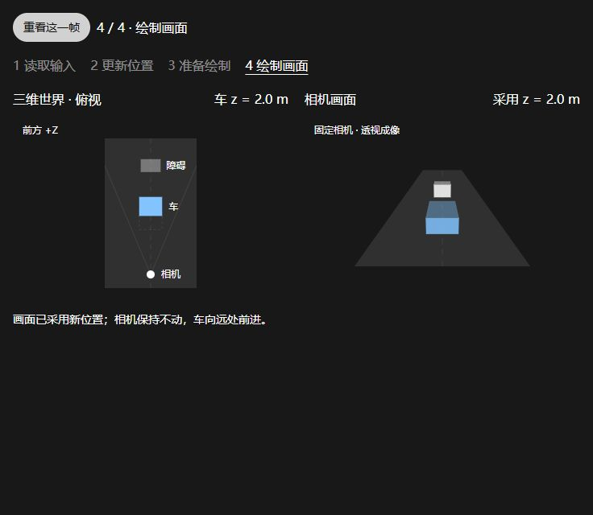

# 输入如何成为一帧画面

[历史参考] 学习者最新要求直接精简原课内容。当前改从[原课重点摘记](http://127.0.0.1:5173/?lab=classics&course=games104&chapter=01)进入，按原讲次列重点与出处，不再增加自编阐述。以下仅保留首版资料与记录。

你按下前进键，车的位置先发生变化，渲染系统再根据车、道路和相机的数据生成画面。**世界中的状态与屏幕上的图像，是相互关联的两种结果。**

本次围绕 GAMES104 的引擎导论，用其配套 Piccolo 的官方源码解释更新与渲染的关系，再联系 Unity 驾驶原型和 GAMES101 的成像知识。下面的分步图与数值例子是辅助解释，不是三门课程共同发布的实验。

[首版 Web 分步示意](http://127.0.0.1:5173/?lab=classics-demo&lesson=frame)：观察世界状态与相机画面，支持上一步、下一步、重看与本机书签。保留为历史参考；[当前入口与修订说明](../../../domains/game-engine/experiments/web3d-learning/docs/classic-web.md)。

## 先沿着一辆车看过程

Unity [Lesson 1.1](https://learn.unity.com/course/create-with-code/unit/unit-1-driving-simulation/tutorial/lesson-1-1-start-your-3d-engines?version=6.0)先把车、障碍和相机放进场景。[Lesson 1.4](https://learn.unity.com/course/create-with-code/unit/unit-1-driving-simulation/tutorial/lesson-1-4-use-user-input-to-control-the-vehicle?version=6.0)才把输入读进脚本，用前后输入控制移动、左右输入控制转向。

这张图表示数据怎样影响后续结果。下面分别看每个环节究竟改变了什么。

## 输入值还不是位置

Unity 1.4 的 Move Action 将方向键或 WASD 绑定为二维输入。只按前进时，可以得到 `(0, 1)`：第一个分量表示左右，第二个表示前后。

这里的 `1` 表示前进输入，并不表示“向上飞一米”。游戏代码决定怎样使用它：本例把前后输入用于沿车辆自身的前方移动，把左右输入用于绕竖直轴转向。输入坐标和三维位置承担不同职责。

此时如果只读了输入，没有执行移动代码，车的位置仍保持原值。按键本身也不会直接重画屏幕。

## 更新先改变世界状态

先假设车辆没有转向，前方与世界 `+Z` 一致。移动的简化关系为：

`新 z = 旧 z + 前进输入 × 速度 × 经过时间`

辅助示意取前进输入 `1`、速度 `5 m/s`、经过时间 `0.4 s`，于是位置从 `z = 0 m` 变为 `z = 2 m`。时间步故意放大，便于看清位移；这些值不代表实际帧率或性能测量。稳定 60 FPS 下，一个约 `1/60 s` 的更新在同样速度下只移动约 `0.083 m`。

经过时间乘以速度，才把“每秒移动多少”转换成“这次移动多少”。车辆转向后，应沿车辆的局部前方计算，不能继续把世界 Z 当作唯一的前进方向。Unity 原课正是用局部前向移动，再绕局部 Y 轴旋转。

当前进键松开时，示例中的前进输入为 `0`，这条移动计算就不再产生前进位移。惯性、加速和轮胎运动需要额外的车辆或物理模型；这一段只讨论原课的直接位移控制。

## 渲染再根据状态生成画面

位置数据更新后，内存中的世界已经改变；屏幕可以仍然保留上一次画面，直到后续绘制与显示完成。交互示意把这两个环节分开：先看左边的位置变化，再看右边采用新位置生成图像。

相机的位置、朝向和投影也参与成像。GAMES101 [Lecture 04](https://sites.cs.ucsb.edu/~lingqi/teaching/resources/GAMES101_Lecture_04.pdf)课件标号第 12 页起用拍照解释物体摆放、相机观察和投影的职责。车改变位置、相机改变位置，或者视角范围改变，都可能让图像发生变化。

辅助示意使用固定的透视相机：车向道路远处前进后，画面中的车会更接近远处、尺寸更小。这来自相机与车辆相对位置的变化。俯视图中的相机标记保持不动，可以帮助区分“车在移动”和“镜头在移动”。

## 回到 GAMES104 配套源码

Piccolo 的官方 [engine.cpp](https://github.com/BoomingTech/Piccolo/blob/2bd7aa50ac4c21888b152c2bfcf321813a7ff8c9/engine/source/runtime/engine.cpp)提供了一个具体的阅读入口。这里固定到该文件的提交 `2bd7aa50`：

`logicalTick`负责推进世界与输入系统，数据交换让渲染系统取得逻辑侧准备的内容，`rendererTick`推进渲染。由此可以看到：游戏引擎要持续组织世界更新、输入、数据与绘制，而图形学进一步解释这些数据怎样形成像素。[GAMES101 的课程范围](https://sites.cs.ucsb.edu/~lingqi/teaching/games101.html)覆盖光栅化、几何、光传播、动画与模拟；[GAMES104](https://games-cn.org/games104/)则围绕引擎及其系统组织展开。

该版 Piccolo 在帧末收集窗口事件，所以前面的概念图不能当作它的逐行调用顺序。事件收集、输入缓存和逻辑读取需要分别追踪。真实引擎还可能让 CPU 与 GPU 并行，并让物理更新与渲染使用不同频率；分步示意只用于看清依赖关系。

## 看交互时只留意三个变化

1. 到“读取输入”时：前进意图已读到，车仍在原位置。
2. 到“更新位置”时：世界中的车已移动，画面仍保留旧位置。
3. 到“绘制画面”时：相机保持固定，新画面开始采用车的新位置。

理解这里的分工后，再读 Update、相机或渲染代码，就可以先判断它影响的是世界状态、观察方式，还是画面生成。

## 原课接续位置

| 课程 | 对应材料 | 接下来沿原课继续的问题 |
| --- | --- | --- |
| GAMES104 | 第一讲引擎导论；配套 Piccolo `engine.cpp` 作为源码旁证 | 第二讲基础架构怎样划分引擎职责？ |
| Unity Create with Code | 1.1 第 3 至 6 步摆放车、障碍和相机；1.4 的输入与移动代码作为本次机制对照 | 先按 1.1 完成场景，再顺序进入 1.2、1.3、1.4，区分物体运动与相机跟随 |
| GAMES101 | 课程介绍中的学科范围；第 4 讲相机与投影作为成像对照 | 结合第 2、3 讲的基础，解释同一位置在不同观察坐标下为何数值不同 |

本文的辅助示意使用几何体、固定相机和软件投影，未复现 Unity 编辑器、Piccolo 运行环境、碰撞或完整 GPU 管线。个人实践与理解在后续操作和自然交流中记录。
