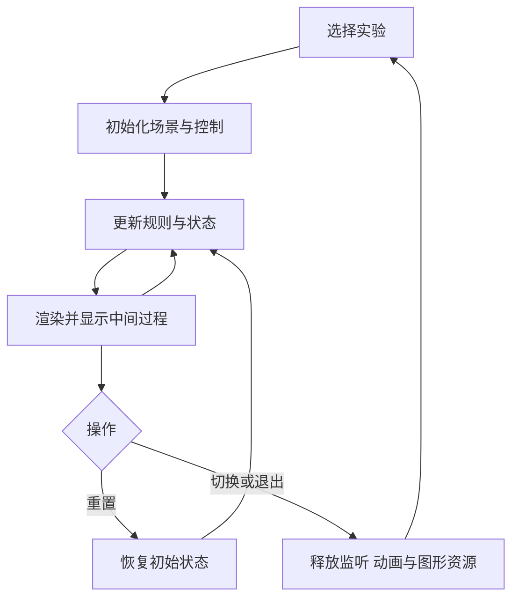

# Web3D 客户端学习实验

一个 Web 工程承载经典课程的图文交互拆解与历史独立实验。当前以 GAMES101、Unity Create with Code、GAMES104 的原章节与例子为依据，不再添加 Cocos 对照。

**[当前入口 · 2026-10-15 深度修订]** 打开[主线与精华](http://127.0.0.1:5173/?lab=classics&course=games101)：每门课都有原章节的问题地图、动机与因果解释，并用采样遗漏、Game Over 状态、系统交接三个案例观察结果差异。按最新要求，正文不安排公式推导与代码步骤。[本轮说明与验证](docs/classic-web.md)。首版三段场景示意及以下阶段 0—6 保留为历史参考。

**[系统学习包] 2026-10-12，阶段 3—6 的 28 课已一次备齐。** [统一导读与图文讲义](docs/course-pack.md)串起模型、动画、玩法、Shader、资源与性能；四个实验台支持中间数据、暂停、逐步、恢复、异常对照与资料入口。先完成内容与校验，再由学习者逐步学习；个人理解单独登记。[校验记录与范围](docs/course-validation.md)

[开始测试] 阶段 0—6 的当前互动内容已完成接续检查。打开[系统课程](http://127.0.0.1:5173/?lab=course&lesson=mesh)，按[手动测试清单](docs/course-user-check.md)切换原理、播放、对照和恢复；清单同时提供逐课检查证据。

**[实现记录] 阶段 0 立方体实验已可运行，支持速度、暂停／继续、重置、相机视角、固定步长对比与退出重入。** 数值检查和核心浏览器交互已验证；后台恢复与 WebGL2 不可用提示待桌面浏览器实测，个人理解待验收。详见[实践步骤与验证记录](docs/stage-00-lab.md)。

**[当前版本] 2026-10-10，阶段 1 已按学习者反馈改为动画与简明原理讲解。** 用“点与箭头”“托盘与小球”“相机与画面”解释空间关系，点击按钮即可看变化；公式和 3D 观察可选展开。填写、手算与记录下载流程已移除，原浏览器笔记不删除。详见[原理动画与验证记录](docs/stage-01-lab.md)。

**[当前阶段] 同日建立阶段 2 场景与运动演示。** 四主题、八个原理与四段动图配合原因、公式、变量与适用条件；支持直接点击画面拾取、暂停、逐步与重播。详见[阶段 2 讲解](docs/stage-02-lab.md)与[演示规格](docs/stage-02-spec.md)。

## 直接开始实践

[启动] 从当前仓库根目录执行：

```powershell
$labRunner = '.\domains\game-engine\experiments\web3d-learning\tools\run.ps1'
powershell -NoProfile -ExecutionPolicy Bypass -File $labRunner install
powershell -NoProfile -ExecutionPolicy Bypass -File $labRunner dev
```

启动器寻找隔离 Node 24.12+，只为当前进程选择运行时，并在本实验目录执行命令。若没有自动找到，为命令传入 `-NodePath` 指定自己的 Node 24 node.exe。默认地址或 `?lab=classics` 进入主线导读并恢复本机书签；`course=games101`、`unity`、`games104` 可直达课程。旧 `lesson` 链接映射到相应课程，首版示意保留在 `?lab=classics-demo&lesson=frame`。`?lab=course`、`motion`、`space`、`time` 保留历史阶段入口。

[验证] `npm test` 检查独立时间与角度逻辑；`npm run build` 执行类型检查和构建。依赖版本由 package-lock.json 固定。

也可使用启动器的 `test`／`build` 命令，避免终端默认 Node 18 与学习工程要求不一致。当前 52 项测试覆盖采样、游戏状态、系统交接、课程书签，以及首版场景与历史实验的数学、模型、玩法、资源和讲义一致性。旧课程的网络链接检查与图文讲义更新方法见[校验记录](docs/course-validation.md)。

## 入口

| 内容 | 入口 |
| --- | --- |
| 当前三门经典课的 Web 交互 | [课程主线、因果对照与来源](docs/classic-web.md) |
| 一次备齐的系统学习包 | [导读、28 课与实践入口](docs/course-pack.md) |
| 四阶段交付检查 | [测试、截图、原始性能记录与边界](docs/course-validation.md) |
| 总路线与资料导航 | [3D 客户端学习路线](../../../../learning-routes/topic-index/3d-game-client.md) |
| 原推荐互联网资料与章节 | [学习资料地图](../../../../learning-routes/resources/3d-game-client-resources.md) |
| 第一周读什么、怎样练习 | [15 小时阅读与实验计划](../../../../user-profile/progress/3d-game-client-week-01.md) |
| 首个实验 | [阶段 0 立方体规格](docs/stage-00-spec.md) |
| 动手实践与实际证据 | [阶段 0 实践](docs/stage-00-lab.md) |
| 下一阶段原理动画 | [阶段 1 动图与简明讲解](docs/stage-01-lab.md) |
| 空间数学演示范围 | [阶段 1 规格](docs/stage-01-spec.md) |
| 当前运动原理与动图 | [阶段 2 讲解](docs/stage-02-lab.md) |
| 运动演示范围与边界 | [阶段 2 规格](docs/stage-02-spec.md) |
| 每个实验的说明格式 | [实验模板](docs/lab-template.md) |
| 阶段通过条件 | [验收规范](docs/acceptance.md) |
| 实际学习记录 | [进度表](../../../../user-profile/progress/3d-game-client-progress.md) |

## 实验内容与生命周期



| 约定 | 后续实现职责 |
| --- | --- |
| 初始化 | 创建实验自身的画布、场景、输入、参数与初始状态 |
| 更新 | 接收明确的模拟时间步长，更新规则；显示时间单位与中间状态 |
| 渲染 | 展示场景、辅助图形和状态；与暂停的模拟时间区分 |
| 重置 | 恢复参数、模拟时间和对象状态，清理临时结果 |
| 释放 | 注销监听与更新任务，停止动画，释放自身拥有的图形资源 |

实验切换界面负责选题与主循环；每个实验拥有明确的资源边界。共享资源需记录所有权，避免一个实验退出时释放另一个仍在使用的资源。

## 每个实验必须能说明什么

| 学习内容 | 展示方式 |
| --- | --- |
| 机制 | 架构图、流程图或坐标图 |
| 实现 | 关键代码及数据流；标明库完成的工作 |
| 过程 | 参数、中间数据、状态、播放时间或事件记录 |
| 结果 | 可重复的操作与预期结果 |
| 原课依据 | 具体章节、原文入口、辅助示意的简化范围 |
| 理解 | 自测答案、验证结论和尚未验证的问题 |

玩法规则组织为独立 TypeScript 模块，渲染适配层展示结果。当前学习页面围绕原课问题、可操作图示、中间状态、原理与来源展开，复杂内容按需查看。

## 阶段 0 的工程准备约束

- 依赖安装、构建与本地服务均在本目录执行。系统 Node 18.15 保留，学习工程使用隔离 Node 24 进程。
- 核对 TypeScript、Vite、Three.js 与类型定义的版本兼容性，提交依赖清单和锁文件；仅为本目录的锁文件添加 Git 忽略例外。
- 使用桌面 Chrome／Edge 的 WebGL2。依赖由工程管理，实验代码不依赖外部 CDN 在运行时加载库。
- 阶段检查按文档事实、纯逻辑、生命周期与浏览器运行分别执行，通过后在主仓库 main 提交推送。

本目录用于学习验证。实际游戏整合后续在明确的项目边界内安排。
