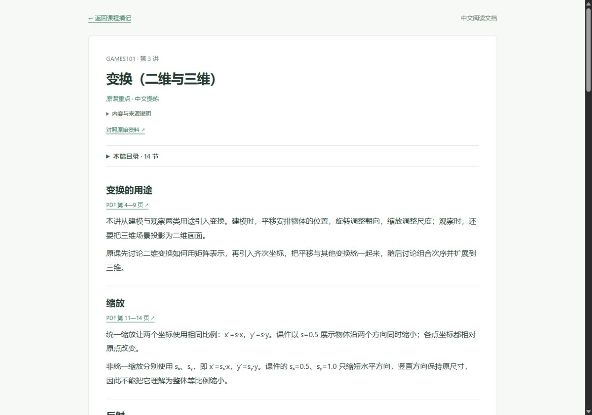
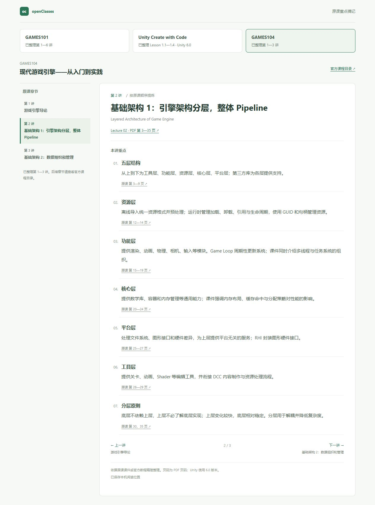
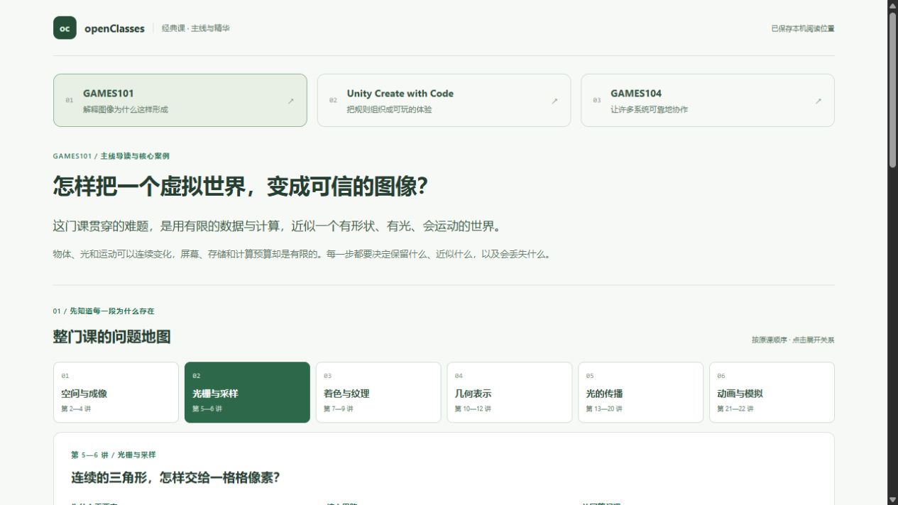
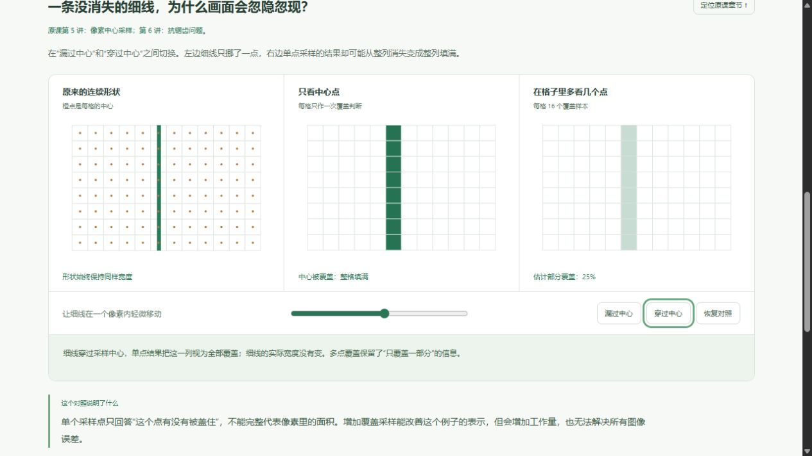
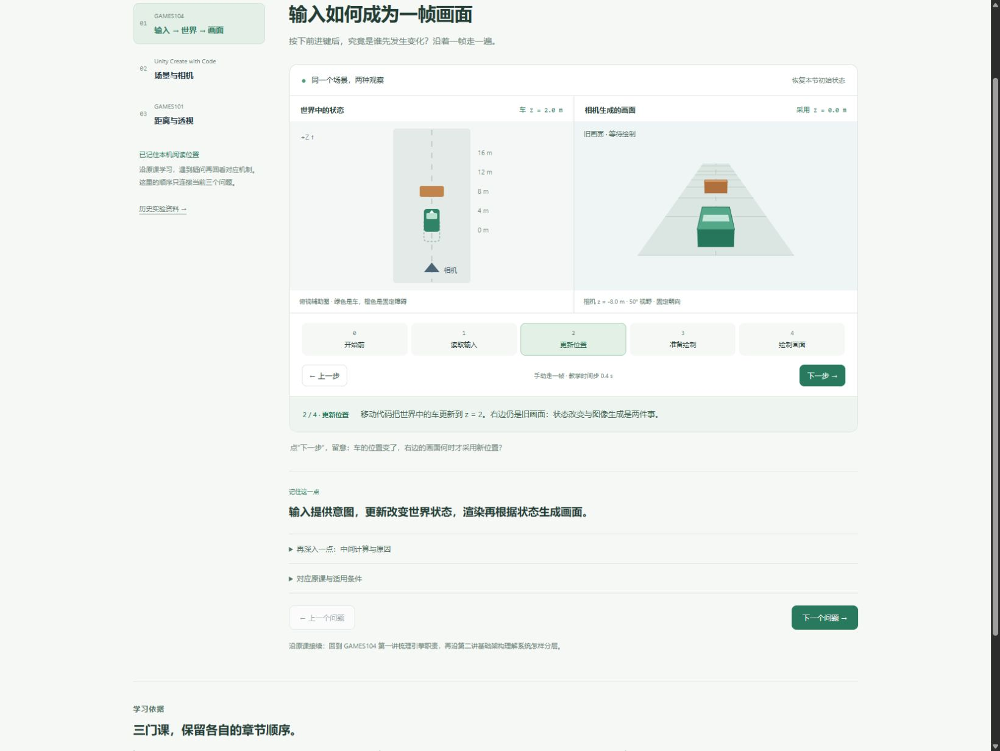

# 三门经典课的 Web 交互学习

## 当前版本：补足中文重点正文（2026-10-20）

根据“每节只有一句话、内容过于简单”的反馈，重新对照英文课件和官方教程修订 91 篇中文文档。章节与来源定位沿用原课，正文保留关键定义、使用条件、数据／空间关系、课内操作要求与结论，合并重复页。篇幅按原文实际密度调整，短导读和测验范围不硬凑长文。

GAMES101 第 3 讲补回缩放与错切的坐标关系、平移与齐次坐标、点和方向向量、仿射表示、可逆条件、组合次序和三维扩展。依据原课第 32—35 页增加两种操作次序的对照图，箭头表示执行顺序，矩阵表达沿原课列向量约定。必要关系式保留为结论，不添加公式推导、自编案例或代码分步。

GAMES104 补足各系统的结构、数据联系、处理方法与适用限制；Unity 保留各原型的具体配置、状态条件、规则结果和挑战要求。技术词先提供中文，必要的原课 UI／API 名称保留，方便回查。阅读页缩减空白，目录、原文链接和返回原章继续可用；主界面导航不变。

### 原文差异核对

Unity 4.3 保留概述“五秒”与正文／脚本“七秒”的差异；6.2 和 ECS 页保留历史 API 范围。5.2 第 7 节仍写 `OnMouseDown`，而末尾脚本使用鼠标输入与射线，中文文档明确两处不同。Challenge 5 第 9 节的提示将 `isPressed` 误述为进入碰撞体；整理校注按 [Unity 官方 ButtonControl 文档](https://docs.unity3d.com/Packages/com.unity.inputsystem@1.11/api/UnityEngine.InputSystem.Controls.ButtonControl.html#UnityEngine_InputSystem_Controls_ButtonControl_isPressed)核对为按钮当前按下状态，并与本帧按下状态区分，来源补标第 4、9 节。

### 本轮验证

验证记录与各篇来源哈希见[中文文档记录](evidence/chinese-readings-2026-10-20.json)。正文内容通过原课核读与交叉抽查检查；字数仅用于发现过度压缩，不作为事实准确性的评分。原有章节 ID、来源 URL 与定位保持可回查。

61 项测试、TypeScript 检查与 Vite 构建通过。新增图示的数据校验覆盖缺失行、空步骤等无效结构；91 篇正文均已修改，保留原章节 ID、原始 URL 和原定位，补标了校注引用的小节。生产目录中的 91 篇 JSON 与源文档一致，更新文档链接检查通过。

浏览器核对第 3 讲正文、目录跳转、两种变换次序、返回原章和入口新页打开，并抽查 Unity 5.2、GAMES104 第 5 讲。桌面 1280 × 900 与手机 320 × 900 检查通过，无横向溢出；手机次序图改为纵向箭头。检查时 error／warn 日志为空，临时视口已恢复，保留第 3 讲的主界面与中文文档。



[原课操作次序对照图](../../../../../docs/game-engine/classic-courses/images/chinese-keypoints-transform-order.png) · [手机次序图](../../../../../docs/game-engine/classic-courses/images/chinese-keypoints-transform-order-mobile.png)

## 中文阅读入口初版（2026-10-20）

在每章原始资料链接旁增加“中文阅读文档”，点击新页打开对应章节。课程卡片、章节目录、重点列表、前后篇和原有阅读书签保持原布局与行为。入口依据来源语言显示：英文或中英混合资料提供入口，中文资料不额外显示。

| 课程 | 中文文档 | 整理小节 |
| --- | --- | --- |
| GAMES101 | 22 篇 | 306 节 |
| Unity Create with Code · 6.0 | 47 篇 | 324 节 |
| GAMES104 已发布课件 | 22 篇 | 176 节 |

初版共 91 篇中文文档、806 个简短小节，按原课页码／小节组织，用自主措辞归纳技术主题。初版页面标注“中文学习整理 · 非全文翻译”，每篇的“内容与来源说明”列明取材范围；图表、公式、代码和视频未完整复刻，Unity 测验仅列题号对应的考查范围，不收录原题、选项或答案。该版正文压缩过度，已由上方的重点正文修订替代。

例如[第 5 讲中文阅读](http://127.0.0.1:5173/?lab=chinese-reading&course=games101&chapter=05)。文档提供折叠目录、可跳转的原文页码／小节来源和返回当前章节的链接；独立文档本身不写入课程书签。中文内容随站点保存，打开时加载当前篇，无需浏览器翻译扩展。无效章节或文档加载失败时显示返回入口。

### 本轮检查

隔离 Node 24.19.0 执行 61 项测试全部通过，TypeScript 检查与 Vite 构建通过。新增检查覆盖语言条件、非法课程／章节、文档结构与来源匹配，以及全部 91 篇文档的存在性、中文正文和 PDF 页码边界；事实核读与来源整理另行完成，不以测试代替内容审阅。[文档来源与哈希记录](evidence/chinese-readings-2026-10-20.json)保留本轮范围。

浏览器实测 GAMES101 第 5 讲入口新页打开、文档目录跳转与返回原章，核对 Unity 1.1 和 GAMES104 第 22 讲的中文入口及正文。三门文档与原课主页面在 320 × 900 下无横向溢出；桌面检查为 1280 × 900。无效章节显示可返回的提示，检查时 error／warn 日志为空。临时视口已恢复，保留 GAMES101 第 5 讲及其中文文档。


[中文文档桌面截图](../../../../../docs/game-engine/classic-courses/images/chinese-reading-desktop.png) · [手机阅读截图](../../../../../docs/game-engine/classic-courses/images/chinese-reading-mobile.png) · [手机主界面](../../../../../docs/game-engine/classic-courses/images/chinese-entry-mobile.png)

## 补齐原课目录（2026-10-20）

在首批 13 讲基础上新增 78 篇，当前共 91 篇。继续按原课程顺序保留原标题、简明课内重点与出处，不另编课程主线、类比、补充案例、公式推导、代码步骤或 Cocos 对照。

| 课程 | 当前范围 | 原始目录 |
| --- | --- | --- |
| GAMES101 | 第 1—22 讲，图形学概述至动画与模拟 | [官方目录与 PDF](https://sites.cs.ucsb.edu/~lingqi/teaching/games101.html) |
| Unity Create with Code | Unity 6.0 全目录 47 篇，含 Getting Started、Unit 1—5、Challenge／Lab／Quiz 与 Next Steps | [官方 6.0 课程](https://learn.unity.com/course/create-with-code?version=6.0) |
| GAMES104 | 官方已发布第 1—22 讲课件，含渲染、动画、物理、工具链、玩法、网络与专题 | [官方已发布课件](https://games-cn.org/games104-slides/) |

[完整逐篇目录与出处](classic-course-index.md)可直接查看每篇范围。GAMES104 的作业 1—3 未作为已完成项目纳入摘记计数；Unity 的挑战、Lab 和测验只整理目标、要求与考查范围，不表示已完成练习或通过测验。

### 本轮材料核对与边界

- GAMES101 新增第 7—22 讲。目录标题与 PDF 内容跨讲的地方按实际 PDF 整理并注明，页码统一为 PDF 的实际页序，不能把讲义内部印刷页码直接当作阅读器页码。
- GAMES104 新增第 4—22 讲，以课件列表及 PDF 内容为准。早期课程大纲与实际发布顺序不同，不能据此声称早期大纲中的所有专题都已逐项覆盖；第 5 讲使用官方实际发布的 `GAMES104_Lecture05_1.pdf`。
- Unity 读取官方版本 6.0 的全部 47 篇目录正文和小节。保留实际原文的小节名称／编号；Next Steps 中 ECS 指南含历史 API 示例，页面标明该边界，不把旧示例当作当前 API 实现指南。
- Challenge 内另行链接的 Bonus Feature 页保留可选性质，未作为本课程目录条目另行拆篇；GAMES104 作业、配套论文与视频演示中的额外内容未据此登记为已完成实践或完整阅读。
- PDF 全文提取、重点页核读与必要图表核对用于编写摘记；中文内容为压缩整理，不是逐字讲稿、完整翻译或全部原图复刻。原 PDF、官方页面与提取缓存位于 Git 忽略的 `.tmp/course-sources/`，不随仓库分发。

### 阅读与接续

沿用原讲次 ID 与既有独立书签，旧链接仍可恢复阅读位置；新增章节也可用 `course`／`chapter` 直接打开。首次阅读从各课目录首篇开始，已有书签保持原位置。默认首页不会因内容补全而将学习者标为已读或提高技能评分。

桌面章节目录可独立滚动并定位当前篇；手机使用“跳转原课章节”下拉选择，避免完整目录占满正文前的屏幕。前后篇、课程切换与原文链接保持可用。

从仓库根目录执行 `powershell -NoProfile -File domains/game-engine/experiments/web3d-learning/tools/run.ps1 dev`。启动器使用隔离 Node 24，保留系统 Node 18。

### 本轮验证（2026-10-20）

隔离 Node 24.19.0 执行测试：57 项通过；TypeScript 检查与 Vite 生产构建通过。新增检查覆盖全部 91 篇的 URL／独立书签恢复、唯一 ID、出处字段、22 讲目录完整性和 Unity 20 讲原型正课顺序；历史实验测试仍保留原范围，不将测试通过作为内容准确性的证明。

原始材料核对包括新增 35 份 PDF 的全文提取、实际技术正文／重点页核读及 12 张复杂图示的选页视觉检查，以及 Unity 官方 6.0 的 47 篇正文与导读字幕。交叉抽查 GAMES101 第 7、12、16、22 讲与 Unity 2.1、4.3、5.1、6.1、ECS，修正了 Unity 2.1 左右边界的定位范围和 6.1 初始化事件的摘记措辞。

[来源校验记录](evidence/classic-courses-2026-10-20.json)保存 44 份 PDF 与 47 篇官方正文的来源和哈希。44 讲的所有页码定位均在对应 PDF 页数内；Unity 47 篇的顺序与 URL 和官方结构化目录逐项相同。页码范围与链接检查不替代课内事实核读。更新文档的本地链接与图片均已检查。

浏览器实测 GAMES101 新增第 7 讲与末讲、GAMES104 末讲、Unity ECS 边界提示与 5.3。验证手机下拉跳转、刷新与无章节参数的首页恢复、课程间独立书签、前后篇与浏览器返回；320 × 900 下三课无横向溢出，手机末篇切回桌面后侧栏可定位当前篇。桌面检查为 1280 × 720，检查时 error／warn 日志为空。临时视口已恢复，页面留在 GAMES101 第 3 讲供继续学习。


[320 像素手机章节选择](../../../../../docs/game-engine/classic-courses/images/full-courses-mobile.jpg)

## 首批版本：原课重点摘记（2026-10-15）

2026-10-15，按最新反馈直接精简课程内容。当前页面只保留原讲标题、课内要点和可定位的出处，沿原课程讲次阅读；移除先前问题地图、自编模拟、类比和跨课程阐述。无公式推导与代码分步。

| 课程 | 本批范围 | 阅读入口 | 原始材料 |
| --- | --- | --- | --- |
| GAMES101 | 第 1—6 讲 | [第 1 讲](http://127.0.0.1:5173/?lab=classics&course=games101&chapter=01) | [官方大纲与课件](https://sites.cs.ucsb.edu/~lingqi/teaching/games101.html) |
| Unity Create with Code | Unit 1，Lesson 1.1—1.4，Unity 6.0 | [Lesson 1.1](http://127.0.0.1:5173/?lab=classics&course=unity&chapter=1.1) | [官方 Unit 1 教程](https://learn.unity.com/course/create-with-code/unit/unit-1-driving-simulation?version=6.0) |
| GAMES104 | 第 1—3 讲 | [第 1 讲](http://127.0.0.1:5173/?lab=classics&course=games104&chapter=01) | [官方课件列表](https://games-cn.org/games104-slides/) |

### 材料核对

本轮实际读取 GAMES101 的六份 PDF、GAMES104 的三份 PDF，以及 Unity 四讲的官方教程正文和 Lesson Recap。GAMES104 课件列表可通过 HTTP 正常访问，本轮使用该列表指向的官方 CDN PDF，不再以配套源码推断讲课内容。PDF 与提取缓存位于 Git 忽略的 `.tmp/course-sources/`，不随仓库分发。

每条要点标注 PDF 页码或教程小节；PDF 链接定位到对应起始页。章节内部归并重复内容，中文为精简整理，并非逐字讲稿；Unity 原编程教学保留内容要点，不展示代码操作步骤。GAMES101 第 6 讲标题沿用官方目录，PDF 内容实际集中在抗锯齿，已在该讲显式注明。

### 阅读与运行

默认首页与 `?lab=classics` 进入摘记。支持课程／章节切换、上一讲／下一讲、浏览器前进后退、外链原文和本机阅读位置保存。`course` 指定课程，`chapter` 使用原讲次 ID；三门课分别保存阅读位置。新书签独立于历史模拟／问题地图，旧 `lesson=frame/scene/projection` 链接仍映射到对应课程。

从仓库根目录执行 `powershell -NoProfile -File domains/game-engine/experiments/web3d-learning/tools/run.ps1 dev`，打开上方本地入口。使用隔离 Node 24，不修改全局 Node 18。

### 本轮验证

隔离 Node 24.19.0 执行 `tools/run.ps1 test`：54 项通过；`tools/run.ps1 build`：类型检查与 Vite 构建通过。新增两项验证原讲次独立书签、URL 优先级、损坏／历史书签与非法链接的恢复。其余测试覆盖历史实验，不作为原课内容准确性的证明。

浏览器实际检查了三门课的章节切换、上一讲／下一讲、刷新恢复及课程间独立阅读位置。320 像素视口下三门课均无横向溢出；第 6 讲的课件范围提示可见，当前页面没有旧地图、模拟案例、代码或画布节点，检查时 error／warn 日志为空。临时视口已恢复。



[320 像素页面证据](../../../../../docs/game-engine/classic-courses/images/original-notes-mobile.png)

材料整理与网页交付不代表个人已经理解，也不代表原生 Unity／Piccolo 实践已经完成。后续沿原课程顺序继续提炼。

## 历史版本：主线、动机与因果（已替代）

2026-10-15，学习者反馈首版过浅、核心内容未提取、讲述含糊，并进一步明确卡点为：不明白原理为什么成立、设计为什么有必要，以及缺少整门课的主线。当前不需要公式推导与代码步骤。

新版入口为 [GAMES101](http://127.0.0.1:5173/?lab=classics&course=games101)、[Unity Create with Code](http://127.0.0.1:5173/?lab=classics&course=unity)、[GAMES104](http://127.0.0.1:5173/?lab=classics&course=games104)。默认首页自动恢复本机阅读课程与地图章节；旧 `lesson=frame/scene/projection` 分别映射到对应课程。

### 学习内容怎样组织

1. 用一句核心问题与具体矛盾建立整门课的主线。
2. 按原课顺序给出问题地图，点击每段可看“为什么需要、核心思路、放回整门课的意义”。
3. 通过有结果差异的案例观察核心矛盾，保留可重置操作与直接的因果解释。
4. 提炼可以迁移到其他问题的判断方法，再说明三门课怎样联系、怎样回到原课。

正文不提供公式推导与代码步骤。地图是本页对原课章节关系的归纳，案例为辅助示意；本轮完成主线导读与三个核心案例，不代表所有原课内容均已深入讲授。

| 课程 | 主线提炼 | 当前核心案例与原因 |
| --- | --- | --- |
| GAMES101 | 表示、采样与近似怎样共同形成图像；理解信息在哪一步损失 | 相同宽度的细线轻微移动，单点结果会漏掉或填满整列；多点覆盖保留部分覆盖信息，用来解释有限采样的损失与代价 |
| Unity Create with Code | 操作、规则、状态与反馈组成一致的可玩循环 | 两边都显示 Game Over，只改界面的一边仍允许生成和计分；遵守状态的一边阻止这些行为，解释界面与规则的分工 |
| GAMES104 | 系统职责、数据归属与交接时机支撑可靠协作 | 世界、交接包、渲染侧分别保留自己的版本；漏交接、接收方未消费、随后消费和追上最新变化有不同结果，解释分工带来的同步成本 |

### 这轮实际核对的原材料

- [GAMES101 官方目录](https://sites.cs.ucsb.edu/~lingqi/teaching/games101.html)：四大组成部分与原始讲次；[Lecture 05 课件](https://sites.cs.ucsb.edu/~lingqi/teaching/resources/GAMES101_Lecture_05.pdf)第 31—39 页讨论三角形、像素中心与采样。多点覆盖为本页进一步构造的对照，不声称复刻原课图像或完整抗锯齿算法。
- [Unity 6.0 官方课程目录](https://learn.unity.com/course/create-with-code)：五个单元与原型安排；[Lesson 5.3 Game Over](https://learn.unity.com/course/create-with-code/unit/unit-5-user-interface/tutorial/lesson-5-3-game-over-2?version=6.0)第 2—4 节明确从文字显示走向游戏状态、停止生成与限制计分。此处采用规则模型，不逐行讲代码。原课程附带的 2019 教学大纲只用于交叉核对原型安排，不替代 6.0 原文。
- [GAMES104 官方大纲](https://games-cn.org/games104/)：架构、数据及各系统的原始讲次；配套 [engine.cpp](https://github.com/BoomingTech/Piccolo/blob/2bd7aa50ac4c21888b152c2bfcf321813a7ff8c9/engine/source/runtime/engine.cpp)、[render_swap_context.h](https://github.com/BoomingTech/Piccolo/blob/2bd7aa50ac4c21888b152c2bfcf321813a7ff8c9/engine/source/runtime/function/render/render_swap_context.h)与[交换实现](https://github.com/BoomingTech/Piccolo/blob/2bd7aa50ac4c21888b152c2bfcf321813a7ff8c9/engine/source/runtime/function/render/render_swap_context.cpp)，固定到 `2bd7aa50`，核对逻辑／渲染交接和待处理数据检查。官方课件列表本轮访问失败，未据此声称读过第二讲完整课件；设计含义明确为本页基于大纲与源码的提炼。

### 运行验证（深度修订版）

隔离 Node 24.19.0 执行 `tools/run.ps1 test`：52 项通过；`tools/run.ps1 build`：类型检查与 Vite 构建通过。新增五项检查覆盖交接前后隔离、未消费包的保护与后续追赶、游戏状态约束与重复计分、采样遗漏与覆盖、损坏或越界课程书签。

浏览器已检查：单点结果在“漏掉／填满”之间改变，多点覆盖保持 25%；Game Over 后生成使目标数为 2／1，计分后分数为 10／0；世界版本 1、画面版本 0 的漏交接状态，以及世界版本 2、待消费包版本 1 的阻塞和随后逐步追赶。章节切换与刷新恢复可用，当前学习页没有公式／代码展示节点。

320 像素下三门课均无横向溢出，并可实际切换、执行对照；736 像素下采样对照与排版正常。三门课的联系另用五个职责节点、因果箭头与玩家反馈回路表示，手机布局已检查。核对了旧 `lesson=scene` 的课程映射和非法旧参数的恢复；检查时浏览器 error／warn 日志为空。临时视口已恢复默认。





[320 像素完整页面证据](../../../../../docs/game-engine/classic-courses/images/principles-mobile.jpg)

源模型边界：采样只处理平面覆盖；Unity 只处理离散规则，未复现协程与引擎等待时序；引擎案例只呈现单物体变化交接，未复现完整队列、GPU 或显示。个人理解与原生项目实践仍未评定。

## 首版记录：场景现象示意（已由上方入口替代）

2026-10-15，按学习者最新要求，将三门原课的问题拆解整理到现有 Web 工程，不再添加 Cocos 对照。首页进入经典课拆解，历史阶段 0—6 从独立入口保留。当前交付以下三个问题，不代表三门完整课程已经全部拆解或个人已经掌握。

## 打开与操作

从仓库根目录启动：

```powershell
powershell -NoProfile -File .\domains\game-engine\experiments\web3d-learning\tools\run.ps1 dev
```

启动器使用隔离 Node 24.12+，保留系统 Node 18。首次缺少依赖时，将命令末尾的 `dev` 换为 `install` 安装工程锁定依赖，再启动。

打开 [Web 学习首页](http://127.0.0.1:5173/)。默认恢复当前浏览器的阅读位置；直接链接优先选择指定问题。只记录阅读与实验参数，不自动评定理解或课程完成率。

| 当前问题 | 交互与观察 | 原课依据 |
| --- | --- | --- |
| [输入如何成为一帧画面](http://127.0.0.1:5173/?lab=classics-demo&lesson=frame) | 手动切换五个阶段，比较世界位置与画面采用的位置；支持前后步进和重看 | GAMES104 引擎导论；Piccolo 固定源码作为旁证，Unity 1.4 输入机制作为原例 |
| [场景与相机](http://127.0.0.1:5173/?lab=classics-demo&lesson=scene) | 前移车，再切换固定／跟随相机；观察相机世界位置与车的画面大小 | Unity 6.0 Create with Code，Lesson 1.1 第 3—6 步；相机跟随是联系 1.3 的辅助对照 |
| [距离与透视](http://127.0.0.1:5173/?lab=classics-demo&lesson=projection) | 独立调整车的位置与 FOV；模型尺寸始终不变，支持单变量预设与恢复 | GAMES101 Lecture 04，课件标号第 12 页起的观测、相机与投影 |

每个问题保留一句关键结论、操作观察提示、按需展开的计算与条件、原课链接和沿原章节接续的位置。三个问题围绕同一场景建立联系，不替代各课原始章节顺序。

## 来源与简化范围

- [GAMES104 官方课程](https://games-cn.org/games104/)与配套 [Piccolo engine.cpp](https://github.com/BoomingTech/Piccolo/blob/2bd7aa50ac4c21888b152c2bfcf321813a7ff8c9/engine/source/runtime/engine.cpp)：区分逻辑更新、数据交换、渲染和事件收集。该版在帧末收集窗口事件，网页阶段表达依赖关系，不能当作源码逐行顺序。
- [Unity Lesson 1.1](https://learn.unity.com/course/create-with-code/unit/unit-1-driving-simulation/tutorial/lesson-1-1-start-your-3d-engines?version=6.0)：Scene／Game 与场景摆放；[Lesson 1.4](https://learn.unity.com/course/create-with-code/unit/unit-1-driving-simulation/tutorial/lesson-1-4-use-user-input-to-control-the-vehicle?version=6.0)用于输入到直接位移的例子。原课实践依次学习 1.1—1.4。
- [GAMES101 Lecture 04 课件](https://sites.cs.ucsb.edu/~lingqi/teaching/resources/GAMES101_Lecture_04.pdf)：三维物体摆放、相机观察与投影；数学前置仍沿[原课程](https://sites.cs.ucsb.edu/~lingqi/teaching/games101.html)复习。

图示是自行实现的几何与软件透视投影，没有复制原课图片。车未旋转时沿世界 +Z 移动；示意以相机前方的正深度表示透视除数，和原课相机看向 −Z 的符号约定要分别理解。未运行原生 Unity／Piccolo，没有惯性、碰撞、完整光栅化或着色管线。0.4 秒为放大的教学时间步，不是实际帧率。

## 本轮验证

2026-10-15，隔离 Node 24.19.0 下执行 `tools/run.ps1 test`：47 项通过；`tools/run.ps1 build`：TypeScript 检查与 Vite 构建通过。新增检查覆盖分阶段状态、零输入与时间步、跟随相机投影不变、距离和 FOV 的独立影响、损坏或越界书签恢复。

内置浏览器已检查：

| 操作 | 实际结果 |
| --- | --- |
| 读取输入 → 更新 → 准备绘制 → 绘制 | 世界先变为 z=2，旧画面仍用 z=0；绘制后采用 z=2 |
| 刷新与 Enter 重播 | 恢复绘制阶段；键盘重播回到初始状态 |
| 固定相机下车前移 2 米，再切跟随 | 相机 z 从 −8 变为 −6；车的投影顶点与初始状态一致，障碍相对变化 |
| 距离与 FOV 预设、键盘滑杆边界 | 分别得到车 z=4／FOV=50°、车 z=0／FOV=80°；键盘可达 z=6／FOV=35°，SVG 没有非有限坐标 |
| 资料与公式展开 | 对应章节、计算、简化范围和资料链接正确出现；当前问题没有 Cocos 对照 |
| 320、736 像素宽度 | 320 下图示上下排列，可切小节与阶段；两种宽度均没有横向溢出 |
| 默认首页与历史入口往返 | 默认地址恢复阅读阶段；历史网格入口可打开，返回后新的分步交互仍可操作 |

检查时浏览器 error／warn 日志为空；已将临时视口恢复默认，并将第一节恢复到开始前供学习者操作。本轮没有自动播放或持续动画循环。历史原生 WebGL 与 Three.js 实验继续保留原验证边界，未据本次检查扩大其结论。个人理解与原课项目实践尚未评定。



[320 像素页面完整截图](../../../../../docs/game-engine/classic-courses/images/web-frame-mobile.jpg)
