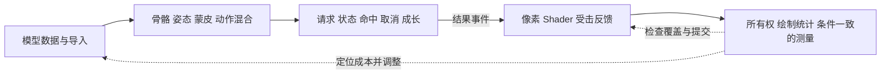

# 3D 客户端系统学习包

[交付范围] 一次备齐阶段 3—6 的 28 课内容、四个实验台和校验记录；阶段 0—2 的已有演示保留。你按目录逐步学，内容不再依赖每次对话临时生成。

[开始学习] 运行 [工程启动器](../README.md) 后，打开 [系统课程首页](http://127.0.0.1:5173/?lab=course&lesson=mesh)。每课看演示 → 切换对照 → 读机制和适用条件 → 点击下一课；浏览器保存阅读书签。

[当前学习位置] 此前进入阶段 2 场景与运动；若仍需回看，打开 [运动演示](http://127.0.0.1:5173/?lab=motion)。观看和交互不自动登记为个人掌握。

| 阶段 | 图文内容 | 交互入口 | 连续课程 |
| --- | --- | --- | --- |
| 3 资产与动画 | [图文讲义](course-stage-3.md) | [开始实验](http://127.0.0.1:5173/?lab=course&lesson=mesh) | 顶点怎样组成模型、导入与坐标约定、UV 与贴图采样、法线与材质、骨骼与绑定姿态、权重怎样使皮肤弯曲、Clip、时间与混合 |
| 4 客户端玩法 | [图文讲义](course-stage-4.md) | [开始实验](http://127.0.0.1:5173/?lab=course&lesson=state) | 请求与状态机、数据驱动攻击、命中窗口与大步、命中去重与无效目标、取消、死亡与事件顺序、Buff、吞噬与成长、敌人感知与迟滞 |
| 5 渲染与表现 | [图文讲义](course-stage-5.md) | [开始实验](http://127.0.0.1:5173/?lab=course&lesson=pipeline) | CPU 到最终像素、纹理与插值、深度与透明顺序、光照与坐标空间、边缘光、溶解与裁剪、命中反馈的时间包络 |
| 6 资源与性能 | [图文讲义](course-stage-6.md) | [开始实验](http://127.0.0.1:5173/?lab=course&lesson=loading) | 加载、引用与竞态、remove 与 dispose、对象池与状态清理、Draw Call 与实例化、LOD 与屏幕误差、透明覆盖与像素成本、测量与结论边界 |

## 已有基础入口

- [阶段 0 帧循环](stage-00-lab.md)：状态、时间与绘制。
- [阶段 1 空间数学](stage-01-lab.md)：向量、父子坐标与投影。
- [阶段 2 场景与运动](stage-02-lab.md)：输入、镜头、拾取与碰撞。
- [核心知识图册](../../../../../docs/game-engine/3d-client-core-visual.md)：七张图回看整体关系。

## 怎样进一步动手

[实践安排] 第一次按 28 课顺序操作按钮，不必边学边写工程。第二遍任选一课，从对应源码修改一个参数，运行现有测试和构建，观察结果是否符合条件。下面给出明确落点：

| 阶段 | 修改入口 | 一次小实践 | 看哪个中间结果 |
| --- | --- | --- | --- |
| 3 | [skin-sample.ts](../src/skin-sample.ts) | 修改 Move 动作幅度，或渐变权重的影响范围 | 姿态、顶点弯曲与两个动作权重 |
| 4 | [course-core.ts](../src/course-core.ts) | 添加一种合法攻击配置并比较取消/命中行为 | 窗口、攻击实例 ID、目标生命与事件 |
| 5 | [render-workbench.ts](../src/render-workbench.ts) | 改边缘光颜色或溶解边缘带宽 | 像素、阈值与时间参数 |
| 6 | [performance-workbench.ts](../src/performance-workbench.ts) | 固定数量比较 Mesh/实例化，导出两份 JSON | calls、triangles、RAF 与 JS 提交分布 |

[资产练习] 内置两骨模型用于机制拆解；阶段 3 的骨骼、蒙皮与混合课可切换现成 CC0 RobotExpressive 角色，检查导入骨架和 Idle/Walking。之后可以在 Blender 做简单网格、UV 和法线检查，再导出引擎支持的格式，按照比例、朝向、材质、骨架与 Clip 清单检查；人体绑定、重定向、IK 与正式项目整合留在扩展范围。原有 [24 周资料计划](../../../../../user-profile/progress/3d-game-client-reading-plan.md) 保留更深入的资料选读范围，时间预算不是推进门槛。

## 交付与验证边界

[证据入口] [校验记录](course-validation.md) 记录测试、浏览器操作、异常路径与限制；[学习进度](../../../../../user-profile/progress/3d-game-client-progress.md) 将实现与个人理解分开。

[模型条件] glTF 为原创矩形夹具；骨骼使用内置两骨样本与现成 CC0 角色；战斗是单目标规则；Shader 球面是片元内解析示意；性能只测当前设备页面的数量、RAF 和 CPU 提交，不测 GPU 时间。商业产品、网络同步、复杂物理、完整 PBR 与跨设备性能验收不在本包范围。

[维护入口] 浏览器与讲义共用 [课程内容](../src/course-data.ts)；[讲义生成器](../tools/build-course-docs.mjs) 负责同步，避免两份解释逐渐不一致。
