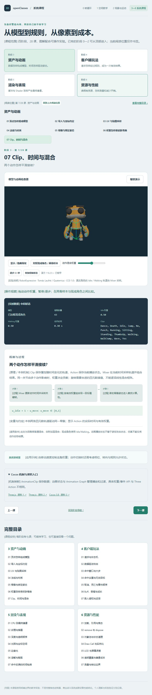
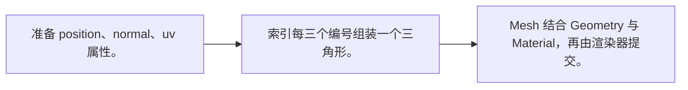
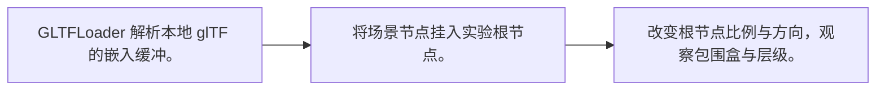
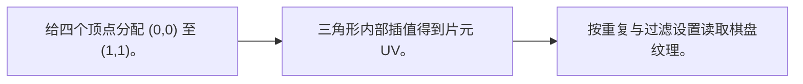
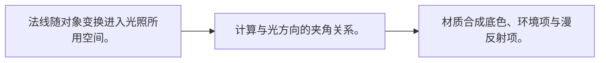
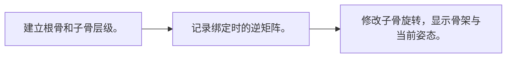
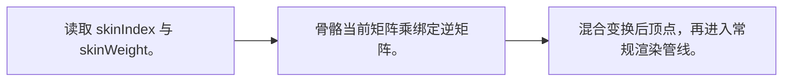
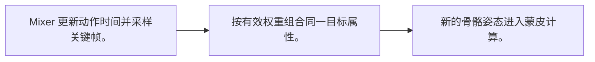

# 阶段 3：资产与动画

[内容版本] 2026-10-12 · 七课 · TypeScript + Three.js / WebGL2 · Cocos 3.8 机制映射。

[学习方式] 每课先打开实验看变化，再读中间过程与条件；随时暂停、逐步、恢复。无需填写、手算或提交答案。观看位置不等于理解验收。

[入口] [系统课程导读](course-pack.md) · [运行与校验说明](course-validation.md)

## 01 顶点怎样组成模型

[学习问题] 为什么四个点能画出一块面？

[操作入口] [打开本课实验](http://127.0.0.1:5173/?lab=course&lesson=mesh) · [关键实现](../src/assets-workbench.ts)

[操作观察] 切换线框，看中间的对角线；查看实际顶点与索引数据。

[原理 / 本例机制] 几何数据保存位置和属性，索引规定每个三角形使用哪些顶点。GPU 不理解“脸”或“手”，它接收属性与图元。一个顶点同时包含位置、UV、法线；同位置若需要不同 UV 或硬边法线，通常要拆成多份顶点。

[公式 / 本例规则] `T0 = (0,1,2)；T1 = (0,2,3)`

[变量与约定] 四个位置 + 六个索引 = 两个三角形；索引编号从 0 开始。

[适用条件] 本课的平面无透视变形；线框显示三角形边，不是碰撞体。索引复用要求完整属性一致。

[游戏应用] 检查破面时先看索引、绕序与背面剔除，再看贴图。

[机制映射] Mesh 保存几何数据；MeshRenderer 将网格与材质交给渲染系统。Node 变换是另一层职责。

[官方资料] [资料 1](https://threejs.org/docs/pages/BufferGeometry.html) · [资料 2](https://docs.cocos.com/creator/3.8/manual/en/asset/model/mesh.html)

[学习顺序] 接着看 02 导入与坐标约定。

## 02 导入与坐标约定

[学习问题] 文件加载完成，为什么模型仍可能不对？

[操作入口] [打开本课实验](http://127.0.0.1:5173/?lab=course&lesson=import) · [关键实现](../src/assets-workbench.ts)

[操作观察] 缩放、转向，然后模拟资源缺失；恢复后查看实际加载状态。

[原理 / 本例机制] 导入器把文件中的缓冲、材质、节点和动画还原成运行时对象。加载成功只代表解析成功；比例、朝向、轴约定、层级和材质支持仍需检查。外部纹理或压缩解码器也可能是独立依赖。

[公式 / 本例规则] `p_world = M_parent × M_local × p_mesh`

[变量与约定] 本例加载仓库内 tiny.gltf，矩形宽 2、高 2；不代表真实角色单位约定。

[适用条件] 本例文件无外部贴图和压缩扩展；缺失文件按钮验证错误路径。真实项目另查导出选项与引擎支持格式。

[游戏应用] 角色站姿、脚底原点、面向和单位在导入时核对，避免靠运动代码补错。

[机制映射] Creator 的模型导入是编辑器资产管线，GLTFLoader 是运行时解析；不能把 glTF URL 直接等同于 Creator 的资产 UUID。

[官方资料] [资料 1](https://threejs.org/docs/pages/GLTFLoader.html) · [资料 2](https://registry.khronos.org/glTF/specs/2.0/glTF-2.0.html) · [资料 3](https://docs.cocos.com/creator/3.8/manual/en/asset/model/mesh.html)

[学习顺序] 接着看 03 UV 与贴图采样。

## 03 UV 与贴图采样

[学习问题] 一张图片怎样贴到两个三角形上？

[操作入口] [打开本课实验](http://127.0.0.1:5173/?lab=course&lesson=uv) · [关键实现](../src/assets-workbench.ts)

[操作观察] 把重复次数从 1 改到 4：模型不变，棋盘变密。

[原理 / 本例机制] UV 是顶点上的二维坐标。光栅化将它插值到片元，采样器按 UV 读取纹理；改变 UV 不会改变网格位置。本例棋盘纹理由代码生成，用重复模式观察取样位置。

[公式 / 本例规则] `uv_sample = uv × repeat；color = texture(uv_sample)`

[变量与约定] UV 无长度单位；repeat 为重复次数。过滤与寻址由纹理状态决定。

[适用条件] 平面示例不演示 UV 展开算法；UV 接缝、图像上下方向和颜色空间需在真实资产中检查。

[游戏应用] 地面铺砖可以重复 UV；角色皮肤通常使用展开后的独立区域。

[机制映射] Mesh 中的纹理坐标与 Material 的纹理/采样状态共同工作；导入选项和 Effect 的坐标处理需分别核对。

[官方资料] [资料 1](https://threejs.org/docs/pages/Texture.html) · [资料 2](https://developer.mozilla.org/en-US/docs/Web/API/WebGL_API/Tutorial/Using_textures_in_WebGL)

[学习顺序] 接着看 04 法线与材质。

## 04 法线与材质

[学习问题] 形状不变，为什么亮暗会改变？

[操作入口] [打开本课实验](http://127.0.0.1:5173/?lab=course&lesson=normal) · [关键实现](../src/assets-workbench.ts)

[操作观察] 打开法线箭头，比较受光材质与不受光材质。

[原理 / 本例机制] 法线描述局部表面的朝向，材质决定使用怎样的光照模型。法线可在相邻面间平滑插值，改变光照外观却不增加几何细节。本实验用 Lambert 材质与旋转光源，突出朝向与亮度的关系。

[公式 / 本例规则] `diffuse ∝ max(0, normalize(n) · normalize(l))`

[变量与约定] n 为表面法线，l 为朝向光源的向量；二者必须处于同一坐标空间。

[适用条件] 公式是漫反射简化式，省略距离衰减、色彩管理和阴影；非均匀缩放下应使用逆转置法线矩阵。

[游戏应用] 法线贴图增加光照细节，不自动改变轮廓或碰撞体。

[机制映射] 法线属性经 Effect 的顶点阶段变换；Material 参数选择光照和贴图行为，MeshRenderer 自身不定义光照公式。

[官方资料] [资料 1](https://threejs.org/docs/pages/MeshLambertMaterial.html) · [资料 2](https://threejs.org/docs/pages/MeshNormalMaterial.html) · [资料 3](https://docs.cocos.com/creator/3.8/manual/en/shader/effect-syntax.html)

[学习顺序] 接着看 05 骨骼与绑定姿态。

## 05 骨骼与绑定姿态

[学习问题] 骨头转动，子骨骼为什么一起移动？

[操作入口] [打开本课实验](http://127.0.0.1:5173/?lab=course&lesson=bones) · [关键实现](../src/assets-workbench.ts)

[操作观察] 切换骨架显示，并对照现成角色；暂停后逐步看关节变化。

[原理 / 本例机制] 骨骼首先是一棵变换层级。子骨的局部变换相对父骨计算，世界姿态由整条父链相乘得到。绑定姿态保存网格与骨架最初的对应关系；骨骼只是变换节点，肉眼可见的线段是调试辅助。

[公式 / 本例规则] `M_child_world = M_parent_world × M_child_local`

[变量与约定] 本例为两骨链；第二根骨的局部位置在第一根骨上端。

[适用条件] 内置两骨样本与现成 CC0 角色用于对照；不涉及自动绑定，IK、重定向和 Root Motion 属于扩展。

[游戏应用] 手持武器可挂到手骨节点；武器位置与角色状态仍需规则约束。

[机制映射] 骨骼通过场景节点层级组织；SkeletalAnimation 驱动姿态，SkinnedMeshRenderer 使用骨架数据变形。

[官方资料] [资料 1](https://threejs.org/docs/pages/Bone.html) · [资料 2](https://threejs.org/docs/pages/Skeleton.html) · [资料 3](https://docs.cocos.com/creator/3.8/manual/en/animation/skeletal-animation.html) · [资料 4](https://raw.githubusercontent.com/mrdoob/three.js/b924f0cad4058dc4dde71445c796980c3cd5b5ed/examples/models/gltf/RobotExpressive/README.md)

[学习顺序] 接着看 06 权重怎样使皮肤弯曲。

## 06 权重怎样使皮肤弯曲

[学习问题] 关节附近的顶点为什么不会整块跳动？

[操作入口] [打开本课实验](http://127.0.0.1:5173/?lab=course&lesson=skin) · [关键实现](../src/assets-workbench.ts)

[操作观察] 比较硬权重与渐变权重，再对照现成角色的骨架和皮肤。

[原理 / 本例机制] 每个顶点保存影响它的骨骼编号与权重。先把绑定姿态的顶点变到当前骨骼姿态，再加权求和。一个顶点同时受两骨影响，过渡区就能弯曲；权重质量影响变形质量。

[公式 / 本例规则] `p′ = B⁻¹ × Σ wᵢ (Mᵢ_current × Mᵢ_bind⁻¹) × B × p`

[变量与约定] B 是网格绑定矩阵；wᵢ 非负且和为 1；M 使用世界骨骼矩阵。

[适用条件] 本例使用线性混合蒙皮；旋转处可出现体积收缩，不声称它解决所有关节变形。硬/渐变权重只修改两骨样本，现成角色保留导入权重。

[游戏应用] 史莱姆可以先用缩放或顶点变形；人体复杂关节需要合适骨架与权重。

[机制映射] SkinnedMeshRenderer 读取骨骼与绑定数据；Cocos 烘焙动画和实时计算动画的路径与可用混合能力不同，迁移前核对。

[官方资料] [资料 1](https://threejs.org/docs/pages/SkinnedMesh.html) · [资料 2](https://docs.cocos.com/creator/3.8/manual/en/animation/skeletal-animation.html)

[学习顺序] 接着看 07 Clip、时间与混合。

## 07 Clip、时间与混合

[学习问题] 两个动作怎样平滑接续？

[操作入口] [打开本课实验](http://127.0.0.1:5173/?lab=course&lesson=blend) · [关键实现](../src/assets-workbench.ts)

[操作观察] 拖动动作权重，暂停/逐步；在两骨样本与现成角色之间比较。

[原理 / 本例机制] Clip 保存属性随时间变化的轨道，Action 保存当前播放状态。Mixer 在当前时间采样轨道并组合结果。同一关节由多个动作影响时，权重决定贡献；旋转需要合适的四元数插值，不能逐项线性混合矩阵。

[公式 / 本例规则] `w_idle = 1 − w_move；w_move ∈ [0,1]`

[变量与约定] 本例两条四元数轨道驱动同一骨骼；显示 Action 的实际时间与有效权重。

[适用条件] 此处为同骨架普通混合，非附加层混合；现成角色使用 Idle/Walking。动画播放状态不等于游戏攻击状态，伤害不能仅凭动作名称结算。

[游戏应用] 由移动速度控制走跑权重；动作切换时还需考虑相位、转向与规则允许状态。

[机制映射] AnimationClip 保存数据；动画状态与 Animation Graph 管理播放和过渡，具体权重/事件 API 与 Three Action 不相同。

[官方资料] [资料 1](https://threejs.org/docs/pages/AnimationMixer.html) · [资料 2](https://threejs.org/docs/pages/AnimationAction.html) · [资料 3](https://docs.cocos.com/creator/3.8/manual/en/animation/marionette/animation-graph-layer.html)

[学习顺序] 进入下一阶段。

[生成约定] 此讲义由 [course-data.ts](../src/course-data.ts) 生成，与浏览器解释共用内容；更新内容后执行 `node tools/build-course-docs.mjs`。
