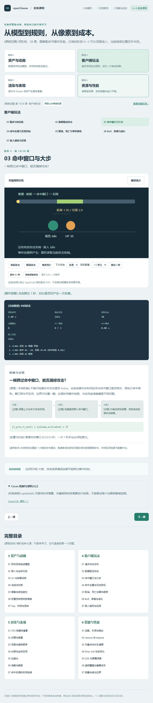
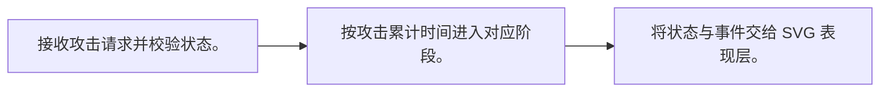
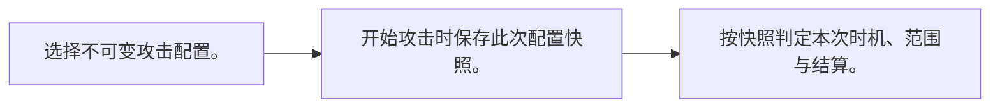
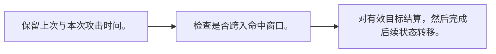
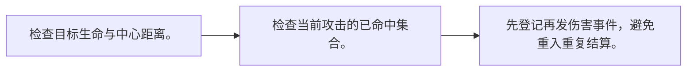
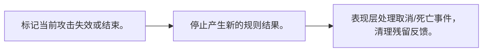
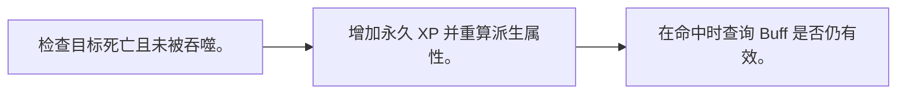
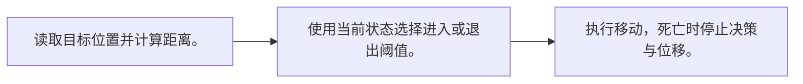

# 阶段 4：客户端玩法

[内容版本] 2026-10-12 · 七课 · TypeScript + Three.js / WebGL2 · Cocos 3.8 机制映射。

[学习方式] 每课先打开实验看变化，再读中间过程与条件；随时暂停、逐步、恢复。无需填写、手算或提交答案。观看位置不等于理解验收。

[入口] [系统课程导读](course-pack.md) · [运行与校验说明](course-validation.md)

## 01 请求与状态机

[学习问题] 按下攻击为什么不一定能攻击？

[操作入口] [打开本课实验](http://127.0.0.1:5173/?lab=course&lesson=state) · [关键实现](../src/gameplay-workbench.ts)

[操作观察] 攻击后立即再次攻击：第二次请求被拒绝，查看事件顺序。

[原理 / 本例机制] 输入产生请求，规则先检查角色是否存活、是否空闲，再决定是否进入攻击状态。状态机让合法转移显式化，表现层依据结果绘制。这里使用空闲→前摇→命中窗口→后摇→空闲的最小规则。

[公式 / 本例规则] `Idle → Windup → Active → Recovery → Idle`

[变量与约定] 时间单位为秒；死亡是不可攻击状态，重置才恢复。

[适用条件] 这是本实验的玩法设计，非所有游戏统一规则；无网络预测、连招输入缓冲或物理求解。

[游戏应用] 让输入、规则与动画分工，可避免动画播放完才发现角色已死亡。

[机制映射] 规则可写成独立 TypeScript 模块；Component 接收输入，Animation 与 VFX 消费规则结果。

[官方资料] [资料 1](https://docs.cocos.com/creator/3.8/manual/en/scripting/life-cycle-callbacks.html)

[学习顺序] 接着看 02 数据驱动攻击。

## 02 数据驱动攻击

[学习问题] 改伤害和时机，需要改状态逻辑吗？

[操作入口] [打开本课实验](http://127.0.0.1:5173/?lab=course&lesson=config) · [关键实现](../src/gameplay-workbench.ts)

[操作观察] 比较普通与重击，观察时机和目标生命。

[原理 / 本例机制] 配置描述伤害、范围与时间窗口，规则执行同一套流程。配置需要校验边界，否则负时间或倒置窗口会让状态不可能到达。表现参数可以与规则配置关联，但不应偷偷决定伤害。

[公式 / 本例规则] `0 ≤ windup < activeEnd < duration`

[变量与约定] 普通：10 伤害；重击：25 伤害且前摇更长；范围均为 2 世界单位。

[适用条件] 切换下次配置不改变已开始攻击；正式项目还需版本、标识符和资源依赖检查。

[游戏应用] 把角色成长与技能数值写成数据，调参时保留规则可追踪性。

[机制映射] 可用序列化属性或配置 Asset；资源加载得到配置后仍需运行时校验。

[官方资料] [资料 1](https://docs.cocos.com/creator/3.8/manual/en/scripting/decorator.html)

[学习顺序] 接着看 03 命中窗口与大步。

## 03 命中窗口与大步

[学习问题] 一帧跨过命中窗口，能否漏掉攻击？

[操作入口] [打开本课实验](http://127.0.0.1:5173/?lab=course&lesson=window) · [关键实现](../src/gameplay-workbench.ts)

[操作观察] 点击跨过 1 秒，对比是否仍产生一次伤害。

[原理 / 本例机制] 不能只检查步末状态是否 Active。应该检查本步时间区间与命中窗口是否相交，再执行命中规则。窗口用半开区间，边界只归属一侧；这是时间事件检测，与空间连续碰撞是不同问题。

[公式 / 本例规则] `[t_prev,t_next) ∩ [windup,activeEnd) ≠ ∅`

[变量与约定] 普通攻击窗口 [0.3,0.5) 秒；一次 1 秒步也必须检查它。

[适用条件] 本例目标位置在一次规则步内固定；高速移动的目标仍需空间扫掠或更细步长，时间区间检测不能替代它。

[游戏应用] 大帧、快进或录像回放都可能跨过事件时刻。

[机制映射] update(dt) 只提供时间增量；关键规则时段需要自行检测，不能假设每个动画帧都被回调。

[官方资料] [资料 1](https://docs.cocos.com/creator/3.8/manual/en/scripting/life-cycle-callbacks.html)

[学习顺序] 接着看 04 命中去重与无效目标。

## 04 命中去重与无效目标

[学习问题] 连续接触三帧为什么不该扣三次血？

[操作入口] [打开本课实验](http://127.0.0.1:5173/?lab=course&lesson=dedupe) · [关键实现](../src/gameplay-workbench.ts)

[操作观察] 在命中窗口连续逐步，生命只下降一次；把目标移到范围外重试。

[原理 / 本例机制] 一次攻击保存已命中的目标集合。范围内且存活的目标第一次进入时结算并登记；后续检测拒绝重复。新攻击创建新集合。目标死亡、越界或标识失效需要在写入伤害前处理。

[公式 / 本例规则] `有效 = 存活 ∧ 在范围内 ∧ targetId ∉ hitSet`

[变量与约定] 去重粒度为“攻击实例 + 目标 ID”；本例单目标，不把整场战斗合并为一次。

[适用条件] 范围用中心距离简化；持续伤害和多段技能需要各自的段 ID 或时间周期。

[游戏应用] 武器碰撞回调可以触发查询，最终去重仍由攻击规则管理。

[机制映射] Collider 事件提供接触信息；组件将目标 ID 交给规则，不直接在每帧碰撞里扣血。

[官方资料] [资料 1](https://docs.cocos.com/creator/3.8/manual/en/physics/physics-event.html)

[学习顺序] 接着看 05 取消、死亡与事件顺序。

## 05 取消、死亡与事件顺序

[学习问题] 攻击取消后，迟来的伤害应该怎样处理？

[操作入口] [打开本课实验](http://127.0.0.1:5173/?lab=course&lesson=cancel) · [关键实现](../src/gameplay-workbench.ts)

[操作观察] 攻击前摇立即取消；再比较命中后取消；死亡后尝试攻击。

[原理 / 本例机制] 取消使当前攻击失效，死亡同时停止攻击与 AI。异步回调应携带攻击实例标识，消费前检查它仍有效；本实验同步规则直接清除攻击状态。已经结算的伤害不因取消自动撤销。

[公式 / 本例规则] `消费条件：角色存活 ∧ attackId == currentAttackId`

[变量与约定] 本例在前摇取消不会命中；命中后取消保留已经产生的结果。

[适用条件] 是否允许后摇取消是设计选择，本例允许；复活、服务器回滚与异步动画事件不在规则实现中。

[游戏应用] 动画还在播放不代表攻击有效，角色死亡后残留回调不能继续扣血。

[机制映射] Animation 事件消费时核对当前规则状态；节点销毁也要解除事件监听与定时任务。

[官方资料] [资料 1](https://docs.cocos.com/creator/3.8/manual/en/animation/animation-event.html)

[学习顺序] 接着看 06 Buff、吞噬与成长。

## 06 Buff、吞噬与成长

[学习问题] 临时加成和永久成长怎样避免混在一起？

[操作入口] [打开本课实验](http://127.0.0.1:5173/?lab=course&lesson=buff) · [关键实现](../src/gameplay-workbench.ts)

[操作观察] 加 Buff 后攻击，再跨过到期时间；击败目标后吞噬并重置目标继续观察成长。

[原理 / 本例机制] 永久经验更新等级；临时 Buff 记录到期时间，并由当前规则时间计算有效加成。本例吞噬只消费已死亡目标且只消费一次。伤害以命中时仍有效的 Buff 为准。等级改变派生范围和基础伤害。

[公式 / 本例规则] `level = 1 + floor(xp/2)；damage = (base + 2×(level−1)) × buff`

[变量与约定] 每个有效吞噬获得 1 XP；Buff 为两倍伤害、持续 2 秒，区间 [start,end)。

[适用条件] 公式是本实验设计；不模拟质量守恒。增益刷新为延长到“当前时间+2 秒”，不叠加倍数。

[游戏应用] 表现可以增大史莱姆，玩法范围要从规则派生，不能从屏幕大小猜。

[机制映射] 规则保存 XP 与 Buff 到期时间；Node 缩放、UI、特效仅展示结果，暂停时钟策略需一致。

[官方资料] [资料 1](https://docs.cocos.com/creator/3.8/manual/en/scripting/life-cycle-callbacks.html)

[学习顺序] 接着看 07 敌人感知与迟滞。

## 07 敌人感知与迟滞

[学习问题] 目标在边界来回移动，为什么敌人会反复切状态？

[操作入口] [打开本课实验](http://127.0.0.1:5173/?lab=course&lesson=ai) · [关键实现](../src/gameplay-workbench.ts)

[操作观察] 在 3、4.5、6 单位间切换距离，观察追逐是否保留。

[原理 / 本例机制] 进入和退出追逐使用不同距离阈值，形成迟滞区，减少边界抖动。状态规则根据距离与生命决策，移动层执行追逐。这里进入距离 4、退出距离 5；在中间区域保留上次状态。

[公式 / 本例规则] `Idle 且 d<4 → Chase；Chase 且 d>5 → Idle`

[变量与约定] d 是中心距离；死亡敌人状态始终 Dead。移动速度为 0.8 单位/秒。

[适用条件] 无寻路、视线遮挡、群体行为或行为树；距离阈值只是最小感知示例。

[游戏应用] 巡逻、追逐、攻击可以增加更多状态，但每个状态都要明确退出条件。

[机制映射] Component 更新感知与规则；NavMesh/路径系统处理障碍绕行，不能由简单直线追逐代替。

[官方资料] [资料 1](https://docs.cocos.com/creator/3.8/manual/en/scripting/life-cycle-callbacks.html)

[学习顺序] 进入下一阶段。

[生成约定] 此讲义由 [course-data.ts](../src/course-data.ts) 生成，与浏览器解释共用内容；更新内容后执行 `node tools/build-course-docs.mjs`。
