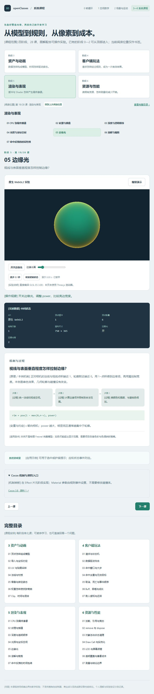
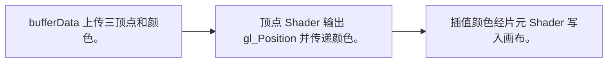
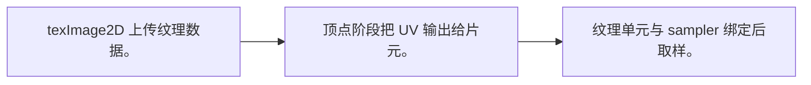
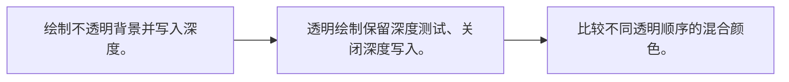
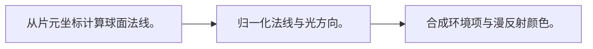
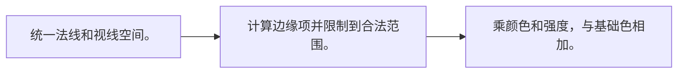
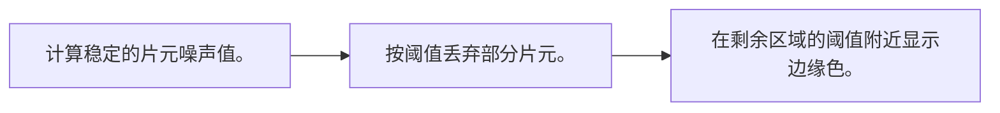
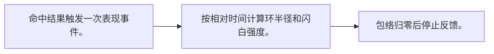

# 阶段 5：渲染与表现

[内容版本] 2026-10-12 · 七课 · TypeScript + Three.js / WebGL2 · Cocos 3.8 机制映射。

[学习方式] 每课先打开实验看变化，再读中间过程与条件；随时暂停、逐步、恢复。无需填写、手算或提交答案。观看位置不等于理解验收。

[入口] [系统课程导读](course-pack.md) · [运行与校验说明](course-validation.md)

## 01 CPU 到最终像素

[学习问题] drawArrays 之后，GPU 做了什么？

[操作入口] [打开本课实验](http://127.0.0.1:5173/?lab=course&lesson=pipeline) · [关键实现](../src/render-workbench.ts)

[操作观察] 关闭顶点颜色对比统一颜色，查看真实 WebGL2 缓冲数量。

[原理 / 本例机制] CPU 上传顶点缓冲、绑定属性和 Shader 参数，再发出绘制命令。顶点阶段输出裁剪坐标，经过裁剪、透视除法和光栅化后形成片元，片元 Shader 决定颜色；深度与混合状态决定是否写入。

[公式 / 本例规则] `buffer → vertex → clipping/raster → fragment → depth/blend`

[变量与约定] 本课直接使用 WebGL2 与 GLSL ES 3.00；三角形坐标已经在裁剪空间，w=1。

[适用条件] 使用 w=1 省略投影矩阵，并非所有 3D 顶点都直接写屏幕坐标；执行次序还受 GPU 优化影响。

[游戏应用] Three.js 帮你组织这些步骤；理解原生过程有助于定位属性缺失与 Shader 问题。

[机制映射] GFX 提供设备与绘制抽象；Effect 组织 Shader，Material 提供参数，渲染管线组织提交。

[官方资料] [资料 1](https://developer.mozilla.org/en-US/docs/Web/API/WebGL_API/Tutorial/Adding_2D_content_to_a_WebGL_context) · [资料 2](https://docs.cocos.com/creator/3.8/manual/en/shader/effect-syntax.html)

[学习顺序] 接着看 02 纹理与插值。

## 02 纹理与插值

[学习问题] 片元怎样知道读图片的哪里？

[操作入口] [打开本课实验](http://127.0.0.1:5173/?lab=course&lesson=texture) · [关键实现](../src/render-workbench.ts)

[操作观察] 改变重复次数，比较顶点几何与片元颜色。

[原理 / 本例机制] 顶点携带 UV，光栅化将其插值到片元。sampler2D 读取已上传纹理；采样状态决定重复和过滤。本例上传 2×2 RGBA 纹理，使用 NEAREST 放大，方便逐块观察。

[公式 / 本例规则] `outColor = texture(uTexture, vUv × repeat)`

[变量与约定] 纹理内容是 4 个颜色块；repeat 默认为 1，可切换为 4。

[适用条件] 这里没有图像网络加载；真实图片另需 CORS、解码和颜色空间处理，MDN 的 WebGL1 NPOT 约束不能直接套到 WebGL2。

[游戏应用] 纹理数据尺寸、压缩与过滤影响清晰度和成本。

[机制映射] Texture2D 管理纹理数据；Effect 声明采样器，Material 绑定纹理与 UV 参数。

[官方资料] [资料 1](https://developer.mozilla.org/en-US/docs/Web/API/WebGL_API/Tutorial/Using_textures_in_WebGL) · [资料 2](https://docs.cocos.com/creator/3.8/manual/en/asset/texture.html)

[学习顺序] 接着看 03 深度与透明顺序。

## 03 深度与透明顺序

[学习问题] 为什么透明物体不能只靠深度测试？

[操作入口] [打开本课实验](http://127.0.0.1:5173/?lab=course&lesson=depth) · [关键实现](../src/render-workbench.ts)

[操作观察] 切换透明绘制顺序，中心重叠区颜色改变。

[原理 / 本例机制] 不透明物体用深度测试选择更近的片元。普通 alpha 混合依赖已经存在的目标颜色，交换绘制顺序通常改变结果。本例关闭透明深度写入，保留深度测试，比较两张透明面远到近与近到远。

[公式 / 本例规则] `C_out = α C_src + (1−α) C_dst`

[变量与约定] 此处为 straight alpha；两张面 α=0.55。深度较小更近，深度比较使用 LESS。

[适用条件] 物体级排序无法解决互相穿插的所有透明面；不是关掉深度测试就能普遍修好。

[游戏应用] 烟雾、玻璃和粒子既影响排序，也增加覆盖像素成本。

[机制映射] Effect 的 pass 状态配置 depthStencilState 与 blendState；透明队列和排序由管线处理。

[官方资料] [资料 1](https://developer.mozilla.org/en-US/docs/Web/API/WebGLRenderingContext/blendFunc) · [资料 2](https://developer.mozilla.org/en-US/docs/Web/API/WebGLRenderingContext/depthMask) · [资料 3](https://docs.cocos.com/creator/3.8/manual/en/shader/pass-parameter-list.html)

[学习顺序] 接着看 04 光照与坐标空间。

## 04 光照与坐标空间

[学习问题] 为什么必须先统一法线、光和视线的空间？

[操作入口] [打开本课实验](http://127.0.0.1:5173/?lab=course&lesson=light) · [关键实现](../src/render-workbench.ts)

[操作观察] 旋转光方向，看球面亮区移动。

[原理 / 本例机制] 点积比较的是同一空间中的方向。法线插值后要重新归一化，再与光方向计算漫反射。实验用解析球面法线展示亮暗；它是片元内的球面示意，不是三角网格球体。

[公式 / 本例规则] `L = ambient + max(0,n·l) × diffuse`

[变量与约定] n 从圆盘坐标恢复球面正面法线；l 为归一化的固定光方向。

[适用条件] 本例无真实阴影、PBR、GI 或法线矩阵变换；用于观察方向关系。

[游戏应用] 亮暗错误时先检查空间、法线和线性色彩处理。

[机制映射] Effect 内保持 n/l/v 空间一致，复杂光照优先查引擎内置着色与管线约定。

[官方资料] [资料 1](https://threejs.org/docs/pages/MeshLambertMaterial.html) · [资料 2](https://docs.cocos.com/creator/3.8/manual/en/shader/effect-syntax.html)

[学习顺序] 接着看 05 边缘光。

## 05 边缘光

[学习问题] 视线与表面垂直程度怎样控制边缘？

[操作入口] [打开本课实验](http://127.0.0.1:5173/?lab=course&lesson=rim) · [关键实现](../src/render-workbench.ts)

[操作观察] 开关边缘光、调整 power，比较亮边宽度。

[原理 / 本例机制] 正对相机的法线与视线点积接近 1，轮廓附近接近 0。用 1−点积得到边缘项，再用幂控制宽度。本例是着色效果，几何轮廓与碰撞没有改变。

[公式 / 本例规则] `rim = pow(1 − max(0,n·v), power)`

[变量与约定] v 朝向相机；power 越大，明显亮区通常越集中于轮廓。

[适用条件] 本例不是物理 Fresnel 完整模型；加色可能超出显示范围，需要项目自身色彩与色调映射策略。

[游戏应用] 可用于选中或护盾提示；应和状态事件对应。

[机制映射] 在 Effect 片元阶段实现；Material 参数由规则事件设置，不需要修改碰撞体。

[官方资料] [资料 1](https://docs.cocos.com/creator/3.8/manual/en/shader/effect-syntax.html)

[学习顺序] 接着看 06 溶解与裁剪。

## 06 溶解与裁剪

[学习问题] 消失是改变透明度，还是丢弃片元？

[操作入口] [打开本课实验](http://127.0.0.1:5173/?lab=course&lesson=dissolve) · [关键实现](../src/render-workbench.ts)

[操作观察] 拖动阈值，看覆盖范围与边缘带；模拟 Shader 编译错误再恢复。

[原理 / 本例机制] 将噪声值与阈值比较，低于阈值的片元 discard；阈值附近另加发光边。它改变写入画布的覆盖范围，CPU 网格与碰撞体仍然存在。噪声需要稳定坐标，才能避免移动时图案漂移。

[公式 / 本例规则] `if noise < threshold: discard；edge = 1−smoothstep(T,T+w,noise)`

[变量与约定] 噪声为 UV 上的确定性函数；T 从 0 到 1，w 为边缘带宽。

[适用条件] 本例噪声是教学函数；discard 不意味着免费绘制，也不会自动禁用目标规则。

[游戏应用] 死亡溶解时规则先停止目标行为，表现再渐变与释放。

[机制映射] Effect 中裁剪；Material 提供阈值，组件在表现时间内更新并在结束后释放对象。

[官方资料] [资料 1](https://docs.cocos.com/creator/3.8/manual/en/shader/effect-syntax.html) · [资料 2](https://developer.mozilla.org/en-US/docs/Web/API/WebGLRenderingContext/compileShader)

[学习顺序] 接着看 07 命中反馈的时间包络。

## 07 命中反馈的时间包络

[学习问题] 闪白、冲击环怎样沿时间变强再衰减？

[操作入口] [打开本课实验](http://127.0.0.1:5173/?lab=course&lesson=feedback) · [关键实现](../src/render-workbench.ts)

[操作观察] 触发反馈，暂停后逐步观察 0.8 秒内的变化。

[原理 / 本例机制] 一次反馈事件保存开始时间，表现用相对时间计算强度，避免每帧累乘导致帧率依赖。实验中的环是片元函数；闪白是颜色混合；它们不负责伤害结算。

[公式 / 本例规则] `strength = max(0, 1 − age/duration)`

[变量与约定] age = 当前表现时间−事件时间；本例 duration=0.8 秒。

[适用条件] 本例为屏幕中的解析效果，无粒子系统、音效或后处理；动画暂停策略与规则时钟分别核对。

[游戏应用] 把命中事件分发给动画、音效、UI 和 VFX，避免多处分别扣血。

[机制映射] 规则结果驱动 Tween/ParticleSystem/Material；结束回调核对对象仍有效，及时取消订阅。

[官方资料] [资料 1](https://docs.cocos.com/creator/3.8/manual/en/particle-system/overview.html)

[学习顺序] 进入下一阶段。

[生成约定] 此讲义由 [course-data.ts](../src/course-data.ts) 生成，与浏览器解释共用内容；更新内容后执行 `node tools/build-course-docs.mjs`。
