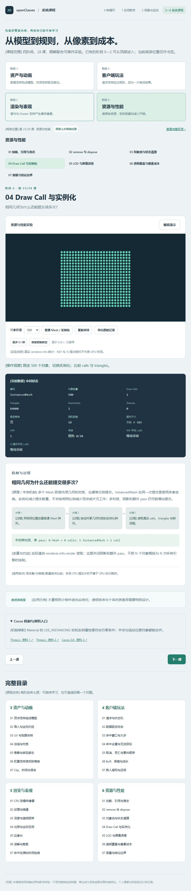
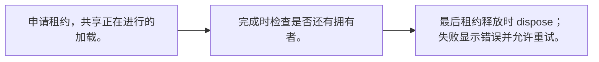
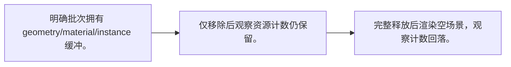
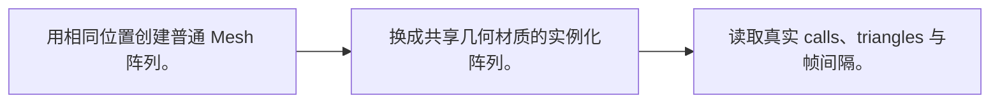
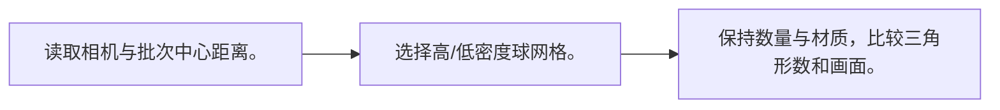

# 阶段 6：资源与性能

[内容版本] 2026-10-12 · 七课 · TypeScript + Three.js / WebGL2 · Cocos 3.8 机制映射。

[学习方式] 每课先打开实验看变化，再读中间过程与条件；随时暂停、逐步、恢复。无需填写、手算或提交答案。观看位置不等于理解验收。

[入口] [系统课程导读](course-pack.md) · [运行与校验说明](course-validation.md)

## 01 加载、引用与竞态

[学习问题] 离开页面后，迟到的资源由谁释放？

[操作入口] [打开本课实验](http://127.0.0.1:5173/?lab=course&lesson=loading) · [关键实现](../src/performance-workbench.ts)

[操作观察] 连续申请两个租约，分别释放；尝试加载中释放和加载失败。

[原理 / 本例机制] 资源有加载中、可用、失败状态。多个消费者可以共享同一次加载，每个消费者持有租约；释放最后一个租约后才销毁资源。加载中释放也必须等待结果后清理，不能把迟到结果重新挂回已退出页面。

[公式 / 本例规则] `owners = acquire 次数 − 已释放租约数`

[变量与约定] 本课使用真实异步 Promise 与本地生成纹理；不测网络速度。一个租约最多释放一次。

[适用条件] 这是教学缓存，不等同于 Cocos AssetManager 的完整依赖图；不支持加载取消信号，但会清理迟到结果。

[游戏应用] 切场景时既要处理已加载资源，也要处理尚未完成的请求。

[机制映射] AssetManager 加载与 Asset 引用计数有各自接口；动态 addRef/decRef 与依赖引用要按手册管理。

[官方资料] [资料 1](https://threejs.org/manual/pages/cleanup.html) · [资料 2](https://docs.cocos.com/creator/3.8/manual/en/asset/release-manager.html)

[学习顺序] 接着看 02 remove 与 dispose。

## 02 remove 与 dispose

[学习问题] 场景里看不见了，资源是否已经释放？

[操作入口] [打开本课实验](http://127.0.0.1:5173/?lab=course&lesson=dispose) · [关键实现](../src/performance-workbench.ts)

[操作观察] 先移除，再完整释放；重建后重复。

[原理 / 本例机制] remove 解除场景层级关系，dispose 释放对象拥有的 GPU 资源。共享几何与材质不能因一个 Mesh 退出就提前销毁。这里比较仅移除对象与销毁整批拥有资源，显示 renderer.info 的数量变化。

[公式 / 本例规则] `退出 = 停止更新 + 解除监听 + remove + 按所有权 dispose`

[变量与约定] geometries/textures 是数量，不是字节；Three 内部可能保留缓存，不能要求所有统计恒为 0。

[适用条件] 数量回落只能验证这批已知资源的清理；不能证明浏览器总内存无泄漏。

[游戏应用] 池内资源仍被池持有，不应该在每次返还对象时 dispose 共享资源。

[机制映射] Node.destroy 与 Asset 引用生命周期是不同层；解除节点不代表所有动态资源引用自动归零。

[官方资料] [资料 1](https://threejs.org/manual/pages/cleanup.html) · [资料 2](https://docs.cocos.com/creator/3.8/manual/en/asset/release-manager.html)

[学习顺序] 接着看 03 对象池与状态清理。

## 03 对象池与状态清理

[学习问题] 复用对象为什么可能带回旧状态？

[操作入口] [打开本课实验](http://127.0.0.1:5173/?lab=course&lesson=pool) · [关键实现](../src/performance-workbench.ts)

[操作观察] 发射、返还、再次发射，对比创建计数与 age。

[原理 / 本例机制] 对象池减少反复创建的分配，但需要重置生命、时间、速度和订阅等临时状态。本例用逻辑粒子池显示创建数、活动数与空闲数，返还时清零 age 并解除 active。

[公式 / 本例规则] `allocated = active + free`

[变量与约定] 本例池上限 20；重复返还被拒绝，清空池释放逻辑对象引用。

[适用条件] 池化不自动减少 Draw Call，也不保证更快；预留过多对象会增加常驻内存。

[游戏应用] 特效对象复用前要重置材质参数、事件和目标引用。

[机制映射] NodePool 的 put/get 与对象自身的 unuse/reuse 协作；共享 Asset 生命周期另行管理。

[官方资料] [资料 1](https://docs.cocos.com/creator/3.8/api/en/classes/NodePool.html)

[学习顺序] 接着看 04 Draw Call 与实例化。

## 04 Draw Call 与实例化

[学习问题] 相同几何为什么还能提交很多次？

[操作入口] [打开本课实验](http://127.0.0.1:5173/?lab=course&lesson=drawcalls) · [关键实现](../src/performance-workbench.ts)

[操作观察] 固定 500 个对象，切换实例化；比较 calls 与 triangles。

[原理 / 本例机制] 多个 Mesh 即使共用几何和材质，也通常分别提交。InstancedMesh 在同一次提交里使用多套变换。实例化减少提交数量，不会按相同比例减少顶点或片元工作；多材质、阴影和额外 pass 仍可能增加提交。

[公式 / 本例规则] `本例单材质、单 pass：N Mesh ≈ N calls；1 InstancedMesh ≈ 1 call`

[变量与约定] 实际值由 renderer.info.render 读取；这里关闭阴影和额外 pass，不把 N 个对象概括为 N 次所有引擎的绘制。

[适用条件] 同设备/分辨率/数量条件比较；本例 CPU 提交计时不等于 GPU 执行耗时。

[游戏应用] 大量相同小物件适合实例化；透明排序与个体材质差异需要特别设计。

[机制映射] Material 的 USE_INSTANCING 宏和实例属性需符合引擎条件；并非勾选后任意对象都能合并。

[官方资料] [资料 1](https://threejs.org/docs/pages/InstancedMesh.html) · [资料 2](https://threejs.org/docs/pages/WebGLRenderer.html) · [资料 3](https://docs.cocos.com/creator/3.8/manual/en/shader/effect-syntax.html)

[学习顺序] 接着看 05 LOD 与屏幕误差。

## 05 LOD 与屏幕误差

[学习问题] 远处模型为什么可以减少细节？

[操作入口] [打开本课实验](http://127.0.0.1:5173/?lab=course&lesson=lod) · [关键实现](../src/performance-workbench.ts)

[操作观察] 切换近/远距离与 LOD 开关，观察实际 triangles。

[原理 / 本例机制] 远物体通常占用更少像素，高密度几何可能带来有限视觉收益。LOD 选择不同网格，降低顶点与三角形处理。这里按相机距离为整批物体切换球网格密度，展示教学阈值与 triangles 变化。

[公式 / 本例规则] `d > 25 → 低细节；否则 → 高细节`

[变量与约定] 这是批次级距离阈值示例，非逐对象自动 LOD；calls 可能不变但 triangles 降低。

[适用条件] 真实项目常按屏幕覆盖与误差选择，并加入迟滞或过渡；不要把本例阈值照搬为性能标准。

[游戏应用] 小屏幕远处敌人可使用简化网格和更少更新，但命中规则应保持一致。

[机制映射] 引擎 LOD 与编辑器设置需按版本核对；手动网格切换也要处理共享资源归属。

[官方资料] [资料 1](https://threejs.org/docs/pages/LOD.html)

[学习顺序] 接着看 06 透明覆盖与像素成本。

## 06 透明覆盖与像素成本

[学习问题] 只有几次绘制，为什么仍可能很慢？

[操作入口] [打开本课实验](http://127.0.0.1:5173/?lab=course&lesson=overdraw) · [关键实现](../src/performance-workbench.ts)

[操作观察] 比较 10/100/500 层与 DPR 1/2，查看分辨率和采样条件。

[原理 / 本例机制] 透明面重叠时多个片元可能覆盖同一像素。实例化可以降低提交，但不能免除这些片元计算与混合。本例固定一块屏幕区域绘制多层透明面，比较层数与 DPR 对帧间隔的影响。

[公式 / 本例规则] `粗略工作量 ∝ 覆盖像素 × 层数 × 每片元成本`

[变量与约定] 这里只改变层数与绘制分辨率；公式是成本直觉，不是准确 GPU 耗时预测。

[适用条件] 帧间隔受刷新率、浏览器调度和设备影响；没有 GPU timer，本页不报告 GPU 毫秒或过绘像素计数。

[游戏应用] 粒子数量、面积和 Shader 复杂度都重要；透明排序问题与填充成本分别分析。

[机制映射] 粒子与透明 pass 增加覆盖成本；用目标设备 profiler 验证，不只看编辑器 FPS。

[官方资料] [资料 1](https://threejs.org/docs/pages/WebGLRenderer.html) · [资料 2](https://developer.mozilla.org/en-US/docs/Web/API/WebGL_API/WebGL_best_practices)

[学习顺序] 接着看 07 测量与结论边界。

## 07 测量与结论边界

[学习问题] 怎样避免把一次 FPS 波动当成优化成果？

[操作入口] [打开本课实验](http://127.0.0.1:5173/?lab=course&lesson=profiling) · [关键实现](../src/performance-workbench.ts)

[操作观察] 完成一轮采样，切换普通/实例化再采样，导出记录。

[原理 / 本例机制] 先保持设备、视口、DPR、对象数量和动画策略一致，预热后采样，再只改变一个因素。帧间隔反映页面回调节奏，JS 提交耗时反映 CPU 侧工作；它们均不直接测得 GPU 耗时。统计分布比单帧更有解释力。

[公式 / 本例规则] `mean = Σdt/N；p95 = 排序后第 ceil(0.95N) 项`

[变量与约定] 本页前 30 帧预热，随后采样 120 帧；记录 UA、画布大小、DPR、模式、数量、calls、triangles。

[适用条件] 浏览器后台停止采样并在恢复时重新预热；减少动画偏好下需手动开始。实验不自动宣称某种方案必然更快。

[游戏应用] 优化目标应是明确瓶颈，数量统计只帮助缩小排查范围。

[机制映射] Profiler 与目标设备性能工具用于进一步区分 CPU/GPU/内存；本页统计不能代替真机测量。

[官方资料] [资料 1](https://threejs.org/docs/pages/WebGLRenderer.html) · [资料 2](https://developer.mozilla.org/en-US/docs/Web/API/Performance/now)

[学习顺序] 回到性能对照，按自己的设备条件比较。

[生成约定] 此讲义由 [course-data.ts](../src/course-data.ts) 生成，与浏览器解释共用内容；更新内容后执行 `node tools/build-course-docs.mjs`。
