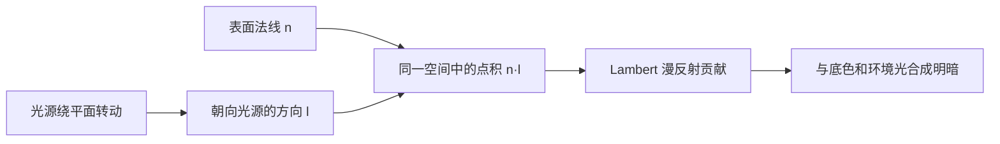
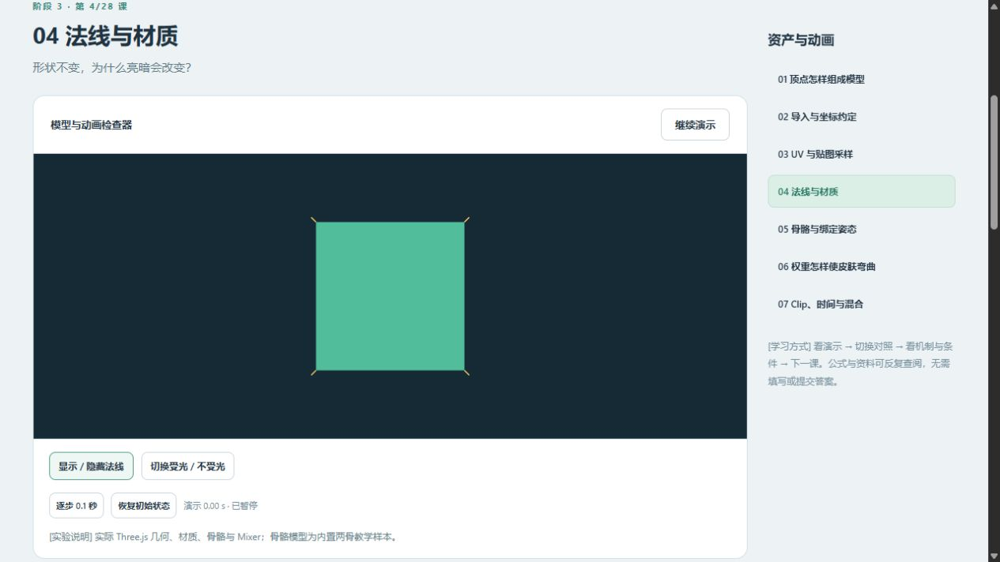
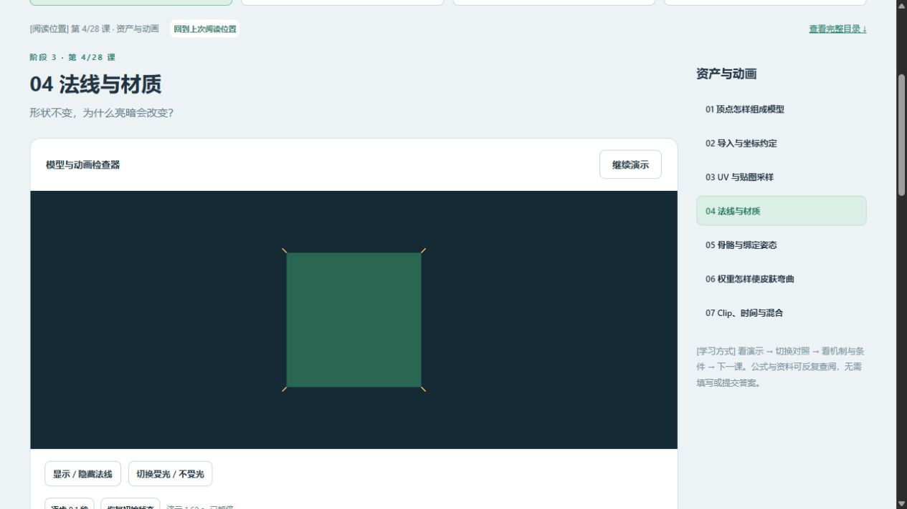
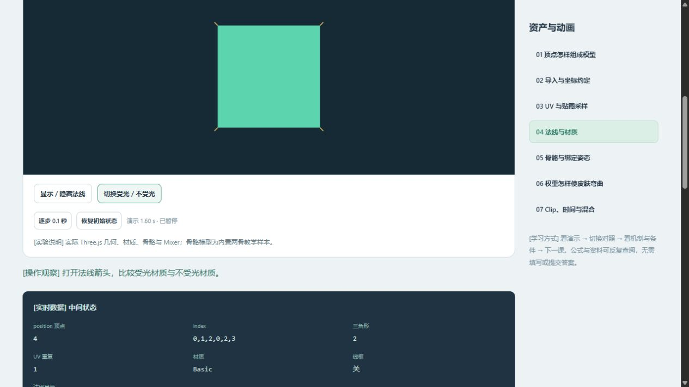
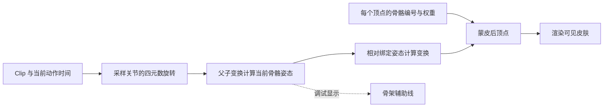
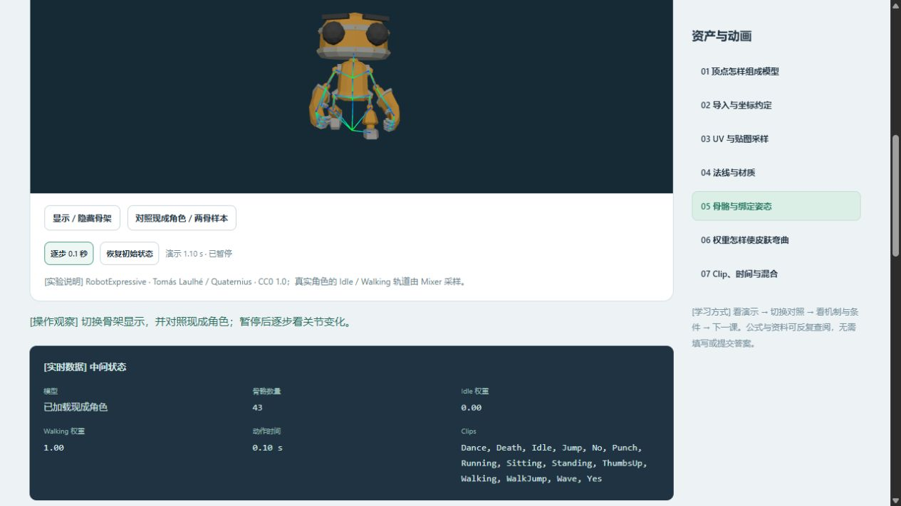

# 互动演示：开始测试

[交付检查] 2026-10-12，当前约定范围的阶段 0—6 互动内容均已实现，本轮检查未发现需要补开发的课程。阶段 0 为一个帧循环实验，阶段 1 有 10 个原理动画，阶段 2 有 8 个运动原理，阶段 3—6 共 28 课。开发与个人理解分别登记。

[测试入口] 本地服务运行后，打开[系统课程首页](http://127.0.0.1:5173/?lab=course&lesson=mesh)。顶部切换阶段 0—2；阶段卡片、完整目录和上一课／下一课用于选择阶段 3—6。

## 先试这些操作

[手动测试] 可任选一项开始，无需填写答案；遇到问题时提供阶段、课名、操作和截图即可。

| 入口 | 操作 | 本轮已观察到的结果 |
| --- | --- | --- |
| [阶段 0：帧循环](http://127.0.0.1:5173/?lab=time) | 分别选择 30、60、120 步／秒，点击“从零验证 2 秒”；再退出并重新进入 | 默认 45 度／秒时，三组均为 2 秒、90 度；退出移除画布，重入创建一个画布 |
| [阶段 1：空间数学](http://127.0.0.1:5173/?lab=space) | 切换三个主题和各个原理，点击对照按钮、暂停及“再看一次” | 10 个原理均显示图解；对照按钮改变对应的图形参数 |
| [阶段 2：场景与运动](http://127.0.0.1:5173/?lab=motion) | 切换四个主题，点击对照、“逐步看”和“从头看” | 8 个原理均可操作；步进为 0.25 秒，重播回到 0 秒；滑动／停止在接触墙后产生不同结果 |
| [阶段 3：资产与动画](http://127.0.0.1:5173/?lab=course&lesson=import) | 模拟资源缺失后恢复模型；第 7 课切换现成角色，将混合权重设为 0.5 | tiny.gltf 恢复加载；角色有 43 个骨骼，Idle／Walking 权重各为 0.50 |
| [阶段 4：客户端玩法](http://127.0.0.1:5173/?lab=course&lesson=window) | 暂停，发起普通攻击后“跨过 1 秒”；重置后发起攻击、取消再跨过 1 秒 | 默认目标 HP 40→30，仅结算一次；前摇取消后仍为 40；死亡后拒绝攻击 |
| [阶段 5：渲染与表现](http://127.0.0.1:5173/?lab=course&lesson=dissolve) | 拖动阈值，模拟编译错误后恢复提示；对照透明顺序 | 编译错误显示说明，有效 Program 保留；透明顺序可切换 |
| [阶段 6：资源与性能](http://127.0.0.1:5173/?lab=course&lesson=drawcalls) | 比较普通／实例化；另看 LOD、资源释放与最后一课采样导出 | 500 对象的 calls 为 500／1；启用 LOD 的远距离 triangles 为 8000；采样完成 120 帧并可导出 JSON |

[共同检查] 阶段 3—6 的 28 课均检查了暂停、逐步 0.1 秒和恢复初始状态；恢复后课程时钟为 0。加载与图形初始化完成后再看中间数据。

## 检查依据

[自动验证] 43 项现有测试、TypeScript 类型检查与 Vite 生产构建通过，36 个去重后的资料链接可访问。

[运行证据] [逐课检查 JSON](evidence/readiness-2026-10-12.json)、[本轮性能采样](evidence/performance-readiness-mesh.json)、[运行截图](images/course-readiness.png)。本轮性能记录为单次普通 Mesh 采样，只用于验证采样与导出流程，不作优化收益比较。

[边界] 真实后台恢复、系统减少动画偏好、无 WebGL2 与真实上下文丢失等未实机覆盖项仍按[原校验记录](course-validation.md)保留。自有资产、原生 Cocos 和扩展主题按原路线另行实践。

[启动] 服务停止时，从仓库根目录运行以下命令，并保持该终端运行：

```powershell
powershell -NoProfile -ExecutionPolicy Bypass -File .\domains\game-engine\experiments\web3d-learning\tools\run.ps1 dev
```

## 2026-10-14 学习接续：法线与骨骼

[本次范围] 接着 10 月 13 日的 UV，使用现有第 4、5 课做交互导读。隔离 Node 24.19.0、Codex 内置浏览器、Three.js 0.186.1；截图视口为 1265 × 712。本次没有修改课程代码，历史 43 项测试和构建不作为本次执行结果。个人理解与实际用时仍待学习者反馈。

### 形状不变，为什么会变暗？

打开[第 4 课](http://127.0.0.1:5173/?lab=course&lesson=normal)，暂停后恢复初始状态，再打开法线显示。法线是表面朝向的向量：它与朝向光源的向量越一致，Lambert 漫反射贡献越大；接近垂直时，贡献接近零。当前平面正对相机，法线也朝向相机，所以箭头投影较短。



| 可复现操作 | 本次观察 | 判断依据 |
| --- | --- | --- |
| 恢复到 0 秒，材质保持 Lambert | 平面较亮 | 记录为 4 个顶点、2 个三角形，索引 `0,1,2,0,2,3` |
| 点击“逐步 0.1 秒”16 次 | 1.60 秒时平面明显变暗，几何与法线显示状态不变 | 光源转到接近侧向；环境光使平面仍有基础亮度 |
| 切换“受光／不受光” | 材质变为 Basic，平面明亮 | [Basic 不受灯光影响](https://threejs.org/docs/pages/MeshBasicMaterial.html) |
| 再逐步 10 次 | 2.60 秒时 Basic 颜色仍保持稳定 | 光源位置继续变化，几何和材质类型不变 |







[机制边界] `max(0, n·l)` 是归一化向量的漫反射简化关系，不能直接拿截图颜色反算点积。环境光、颜色处理等也影响画面。本例不修改法线数据，也不演示法线贴图；法线贴图影响光照细节而不会自动增加几何轮廓。[Lambert 官方说明](https://threejs.org/docs/pages/MeshLambertMaterial.html)

### 时间怎样成为关节姿态？

进入[第 5 课](http://127.0.0.1:5173/?lab=course&lesson=bones)，保持暂停并逐步。两骨样本在 0、0.50、1.00 秒的关节角度分别为 −37.2°、0.0°、+37.2°；始终为 26 个顶点、2 根骨骼，Idle／Move 权重为 0／1。切换骨架显示只改变辅助线，保持皮肤和播放时间。



骨骼是变换层级中的节点，[Three.js Bone 继承 Object3D](https://threejs.org/docs/pages/Bone.html)。子骨的世界变换为 `M_parent_world × M_child_local`。绑定姿态记录网格与骨架的参考关系；“恢复初始状态”回到动画首帧，不等于回到绑定姿态。本样本绑定时关节为零旋转，Move 的首帧为 −0.65 rad（约 −37.2°），因此恢复后仍可看到弯曲。

[角色对照] 切换现成角色，等待显示“已加载现成角色”，再逐步一次：43 根骨骼、14 个 Clip，Idle／Walking 权重为 0／1，角色动作时间 0.10 秒。此时课程总时钟为 1.10 秒，角色是在加载完成后才开始播放，两种时间不同。暂停状态下切换角色后，用一次逐步刷新姿态和画面，再观察权重。



[Cocos 对照] 当前资产课的法线通过 Effect 参与光照；骨骼用场景节点组织，SkeletalAnimation 驱动姿态，SkinnedMeshRenderer 使用绑定与权重数据完成变形。烘焙与实时计算路径的差异按[现有动画资料](../../../guides/cocos-source-learning/04-functional-modules/01-animation-system.md)继续查阅，本次未运行原生 Cocos 实验。

[本次检查] 实际完成法线显示、固定步进、材质切换、骨架显示和角色加载对照；检查时浏览器 error／warn 日志为空。检查新增截图与本地文档链接、Git 差异格式；原有未实机覆盖项继续保留。

[下一次接续] 进入[第 6 课蒙皮权重](http://127.0.0.1:5173/?lab=course&lesson=skin)，在同一暂停姿态切换渐变／硬权重，观察同一骨骼运动为何形成不同的关节变形；再接第 7 课动作混合。
