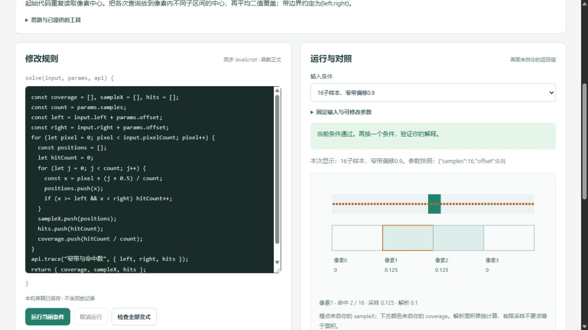

# 首批代码实践验收 · 2026-10-22

交付 4 个可运行实验、5 个独立任务、28 组固定输入；31 的 3 组输入共 65 个事件。其余 56 个实验为计划中。[范围与运行规则](practice-learning.md) · [60 项覆盖清单](practice-coverage.md)。材料就绪不等于个人已学会，个人理解仍未评定。

## 自动验证

使用隔离 Node 24.19.0，实际运行 `tools/run.ps1 test`：102 项测试通过（原有 61 项与新增 41 项），无失败、跳过或取消。`tools/run.ps1 build` 的 TypeScript 检查与 Vite 生产构建通过。没有增加依赖或修改锁文件。

新增检查覆盖：独立解析／期望表、正确解与已知错误、变换方向和中心、暂停有效时间、半开采样边界、状态与会话、重复点击、同时间事件顺序、重玩清理、难度重算、输入快照、中间记录复制、超限和无效输出、取消／超时后重跑、迟到消息、草稿版本与不完整文本、返回白名单及 60 项原课定位。真实 Node Worker 加载生产 Worker 入口，确认伪造协议消息或改写全局发送函数不能替换实际返回结果。

## 浏览器验证

在 Codex 内置 Chromium 中操作开发服务和生产预览，记录见[浏览器证据](evidence/practice-browser-2026-10-22.json)。生产构建中四个实验的全部 28 组输入通过，包含 02 的两个任务；该新会话检查时 warn／error 为空。开发中曾出现一次新导出尚未落地的热更新错误，修复后重新构建、打开生产预览验证。

| 实际操作 | 观察结果 |
| --- | --- |
| 02 起始错误 → 正确代码 → 全部变式 | 初始次序产生坐标差异；两个任务分别通过 4／3 组输入 |
| 04 手动修正 dt 与暂停条件 | 6 组通过；输入经过 4 秒、有效模拟 2 秒、位置 40；暂停步形成平台段 |
| 09 修正子样本位置 → 12 组输入 | 全部通过；16 样本／偏移 0.9 时像素 1 采样 0.125、解析 0.1，二者明确分开 |
| 31 初始门禁错误 → 正确实现 → 3 组输入 | 初始标题阶段多出调度；正确实现通过状态表；最后重玩回标题、分数／目标／调度清零 |
| 语法错误、抛异常、NaN、缺字段、1001 条记录、1 MiB 文本 | 分别提示对应错误；旧图示清空，不显示参考图冒充结果 |
| `while(true) {}` | 3 秒后终止；页面继续可操作 |
| 运行死循环 → 取消 → 修改并再跑 | 新运行通过；旧运行不会覆盖新结果（迟到协议另有测试） |
| 31 参数改为未编写期望表的条件 | 单独提示“独立基准失败”，重置后可再次通过 |
| 09 未完成参数 JSON 与代码注释 → 刷新 | 原样恢复代码和文本；没有自动执行 |
| 场景重置、恢复初始代码、撤销恢复 | 场景重置保留代码；撤销后能运行通过 |
| 从中文小节进入／返回、从课程摘记进入／返回 | 分别返回 Unity 5.2#part-4 和 5.2 摘记；原导航与正文正常 |
| 桌面、320×740 手机 | 桌面并排、手机纵向；手机文档宽度与滚动宽度均 305px（视口扣除滚动条），没有横向溢出；采样图文字实测高 12px |

桌面真实结果：

[采样完整页面](images/practice-sampling-full-2026-10-22.png) · [手机采样图](images/practice-sampling-mobile-2026-10-22.png) · [手机游戏流程](images/practice-game-mobile-2026-10-22.png) · [暂停与有效时间](images/practice-time-2026-10-22.png)

临时视口已恢复，生产预览仅用于检查；学习仍使用 5173 服务。未在浏览器注入存储故障：存储不可用分支经代码复核，坏草稿与版本隔离由模型测试核对，不冒充浏览器实测。没有运行原生 Unity 或把 CPU／离散模型称为完整引擎实现。

下一阶段按同一验收要求扩展基础机制，再推进动态系统与进阶专题；可运行数量、知识覆盖和个人解释继续分开记录。
