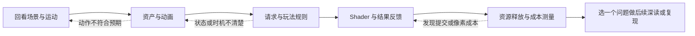

# openClasses 当前进展与下一步学习计划

[历史快照] 2026-10-15，学习者改选 GAMES101、Unity Create with Code、Three.js Journey 沿原课程深入学习。下文保留 10 月 12 日的检查与四周安排，不再作为当前逐课接续顺序；最新入口见[三门课程路线](../../learning-routes/topic-index/3d-game-client.md)与[当前进度](3d-game-client-progress.md)。

截至 2026-10-12，3D 客户端主线已经具备阶段 0—6 的入门教学内容：阶段 0 的帧循环实验、阶段 1 的 10 个原理动画、阶段 2 的 8 个运动原理，以及阶段 3—6 的 28 课和四个实验台。下一步使用[现有系统学习包](../../domains/game-engine/experiments/web3d-learning/docs/course-pack.md)，先接续场景与运动，再学习资产与动画。

以下四周是首轮导读与小实践，参考[学习偏好](../learning-preferences.json)中的每周 15 小时，共 60 小时；不是完成全部 24 周路线或掌握所有技能的期限。若某个机制仍不清楚，使用当周缓冲回看动画，后续内容顺延。个人理解在自然交流与操作中确认，不要求填写、手算或提交答案。

## 当前进展

| 方向 | 当前状态 | 下一步 |
| --- | --- | --- |
| 3D 客户端基础 | 阶段 0—2 已实现并有核心运行证据 | 回看镜头相对方向、时间步长、拾取与碰撞，接续阶段 3 |
| 资产与动画 | 阶段 3 七课已交付，含本地模型、两骨样本和现成角色 | 观察顶点、UV、法线、骨架、权重和动作混合，做一次参数修改 |
| 客户端玩法 | 阶段 4 七课已交付，含单目标攻击、取消、成长和敌人迟滞 | 追踪请求、状态、命中与事件，比较取消前后的结果 |
| 渲染与性能 | 阶段 5、6 各七课已交付 | 后续两周观察 Shader、生命周期与同条件采样 |
| 基础 AI 课程 | 档案记录 CS146S、Hello-Agents、Prompt 设计与优化已完成 | 按问题查阅已有笔记 |
| Agent 进阶与论文 | OpenClaw 档案记录进行中；[Agent 评估方案](2026-10-agent-evaluation-plan.md)尚未启动 | 保留方向，3D 主线复盘后再选一个明确问题 |
| 引擎源码与 Demo | 已有 Cocos、Godot 指南与 slayDemo 学习资料 | 每次只读与当前实验对应的机制；正式游戏整合按独立项目边界安排 |

[学习进度](3d-game-client-progress.md)中的阶段 0—6 个人理解均尚未评定。[技能矩阵](../skill-matrix.json)仍为 2026-04-17 自评，不能根据课程交付、阅读书签或测试通过提高评分。当前优先补充可观察的操作与机制解释，围绕模型到动画、请求到命中、资源到释放建立联系。

## 本次检查结果

| 检查 | 结果与依据 |
| --- | --- |
| Git 状态 | 复核开始时工作区干净，位于 main；拉取远程引用后与 origin/main 无差异，基线为 `578e6a0f` |
| 现有测试 | 本次使用隔离 Node 24.19.0 运行，43 项通过，0 项失败 |
| 类型与构建 | 本次 TypeScript 检查和 Vite 生产构建通过 |
| 课程运行证据 | [10 月 12 日接续检查](../../domains/game-engine/experiments/web3d-learning/docs/course-user-check.md)及[逐课 JSON](../../domains/game-engine/experiments/web3d-learning/docs/evidence/readiness-2026-10-12.json)覆盖 10 个空间原理、8 个运动原理与 28 课；本次核对记录，未重复浏览器实测 |
| 运行边界 | 阶段 0 的桌面后台恢复、无 WebGL2，以及系统减少动画偏好、真实上下文丢失等仍按[校验范围](../../domains/game-engine/experiments/web3d-learning/docs/course-validation.md)保留待实机验证 |
| 子模块 | `git submodule status` 仍因 OpenGame_source 缺少 .gitmodules 映射报错；不影响当前 Web3D 测试和构建 |

## 四周首轮安排

每周预算为演示与机制讲解 8 小时、相关资料与 Cocos 对照 2 小时、小实践 3 小时、问题修正与复盘缓冲 2 小时。资料从对应讲义内按需打开；[24 周阅读计划](3d-game-client-reading-plan.md)保留深读范围。

| 日期 | 学习范围 | 操作与小实践 | 阶段检查点 |
| --- | --- | --- | --- |
| 10 月 12—18 日 | 阶段 2 接续；[阶段 3 资产与动画](../../domains/game-engine/experiments/web3d-learning/docs/course-stage-3.md)七课 | 先看运动对照，再按网格／导入 → UV／法线 → 骨骼／蒙皮 → 动作混合顺序操作；第二遍在 skin-sample.ts 修改一次动作幅度并观察 | 能结合画面解释网格属性、骨骼姿态与混合权重各改变什么；保存修改前后观察结果 |
| 10 月 19—25 日 | [阶段 4 客户端玩法](../../domains/game-engine/experiments/web3d-learning/docs/course-stage-4.md)七课 | 比较普通攻击、大步跨窗、取消、死亡、Buff 与成长；第二遍在 course-core.ts 调整一组合法攻击配置 | 能顺着中间数据说明一次攻击为何命中或被取消，并区分临时加成与永久成长 |
| 10 月 26 日—11 月 1 日 | [阶段 5 渲染与表现](../../domains/game-engine/experiments/web3d-learning/docs/course-stage-5.md)七课 | 观察纹理、深度、透明顺序与光照空间；在 render-workbench.ts 修改边缘光颜色或溶解边缘带宽 | 能把参数、Shader 计算与像素变化联系起来，说明效果的适用条件 |
| 11 月 2—8 日 | [阶段 6 资源与性能](../../domains/game-engine/experiments/web3d-learning/docs/course-stage-6.md)七课 | 比较 remove／dispose、对象池、实例化与 LOD；固定数量、分辨率和相机条件导出普通／实例化两份采样 | 能区分绘制次数、RAF 间隔与 CPU 提交时间；结论只覆盖实际测量条件 |

小实践入口与中间结果见[系统学习包的动手安排](../../domains/game-engine/experiments/web3d-learning/docs/course-pack.md#怎样进一步动手)。实际修改代码时由 Agent 完成对应现有测试、构建与关键运行检查，再按仓库规则提交推送。



## 下一次学习

建议用 55 分钟完成一次接续：

| 时间 | 动作 | 观察重点 |
| --- | --- | --- |
| 10 分钟 | 回看[阶段 2](../../domains/game-engine/experiments/web3d-learning/docs/stage-02-lab.md)镜头相对方向与碰撞对照 | 镜头转动怎样改变输入方向；拾取与体积碰撞分别判断什么 |
| 20 分钟 | 打开[第 1 课网格](http://127.0.0.1:5173/?lab=course&lesson=mesh)，切换线框 | 四个顶点和六个索引怎样组成两个三角形；中间对角线从哪里来 |
| 15 分钟 | 进入[第 2 课导入](http://127.0.0.1:5173/?lab=course&lesson=import)，调整比例／朝向，模拟缺失再恢复 | 解析成功与比例、朝向、层级正确分别需要检查什么 |
| 10 分钟 | 回看本课机制、条件和 Cocos 对照 | 有疑问就围绕当前画面讲解，下一次从 UV 接续 |

本地服务停止时，从仓库根目录启动并保持终端运行：

```powershell
powershell -NoProfile -ExecutionPolicy Bypass -File .\domains\game-engine\experiments\web3d-learning\tools\run.ps1 dev
```

浏览器会保存课程书签；它只表示阅读位置。阶段 2 是最后有用户安排依据的学习位置，阶段 3 从第一课接续是本次建议。

## 维护与后续选择

| 优先级 | 事项 | 完成条件 |
| --- | --- | --- |
| 近期 | 在桌面 Chrome／Edge 补查后台恢复、系统减少动画偏好、无 WebGL2 与上下文丢失处理 | 保存环境、步骤和结果；无法实测的项继续注明边界 |
| 全量子模块同步前 | 核实 OpenGame 上游地址及当前提交，再补齐 .gitmodules 映射 | 子模块状态可查询，引用可从上游获取；学习子模块内不开发或提交 |
| 四周复盘后 | 依据实际问题选择自有资产导入、Cocos 最小复现，或 Agent 评估中的一项 | 明确问题、输入、可观察结果和项目边界，再估算时间；需要外部项目时先确认根目录 |

建议 10 月 18 日首次复盘，10 月 25 日检查资产与规则的联系，11 月 8 日调整后续深读范围；实际节奏以学习反馈为准。

10 月 8—9 日的阶段 0 启动计划保留为历史快照，当前执行顺序以本计划与[系统学习包](../../domains/game-engine/experiments/web3d-learning/docs/course-pack.md)为准。
