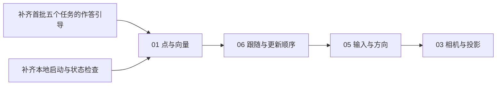

# 学习 Web 项目复核与下一步计划 · 2026-10-24

## 本次结论

已在 `main` 从个人远程 `origin/main` 拉取，结果为 Already up to date；复核基线为 `85b96790`，拉取时工作区干净。本次整理进展、修正计划项来源并形成下一阶段规格，不开发新实验或调整既有学习者评分。

| 范围 | 核实结果 | 含义 |
| --- | --- | --- |
| 原课阅读 | GAMES101 22 篇、Unity 47 篇、GAMES104 22 篇，共 91 篇、806 个中文小节 | 按原课顺序整理，保留出处与阅读位置 |
| 首批实践 | 02／04／09／31，共 4 个实验、5 个任务、28 组固定条件 | 已有可编辑代码、独立基准、真实图示、回放及版本草稿 |
| 知识映射 | 上述任务对应 21 个原课小节中的指定机制 | 不表示整节、整门课或全部知识已实践覆盖 |
| 待开发 | 60 个稳定编号中 56 个计划中 | 目录登记不等于可运行交付 |
| 个人学习 | 已交流 02 的题意和作答位置，尚未确认独立完成及理解 | 浏览器草稿和解释单独保存，不因 Agent 验证自动登记掌握 |
| 本次自动验证 | 102 项测试通过；类型检查与生产构建通过 | 10 月 24 日实际重跑，非引用历史结果 |
| 本地服务 | 检查时 5173 无监听；重新构建后恢复同地址，课程、实践和中文 JSON 的 HEAD 请求均为 200 | 已恢复服务响应；本次未重做浏览器渲染验收，未查明上次进程退出原因 |

已有实现与边界见[实践说明](../../domains/game-engine/experiments/web3d-learning/docs/practice-learning.md)、[首批验收](../../domains/game-engine/experiments/web3d-learning/docs/practice-validation.md)、[机制清单](../../domains/game-engine/experiments/web3d-learning/docs/practice-coverage.md)。旧实验与原生 Unity／Piccolo 实践范围继续分别记录。

## 下一步顺序

原课阅读仍沿原章节；图中是实现依赖和交付顺序，不另编课程主线。A、B 可独立推进，达到下面的使用验收后再增加可运行数量。新实验先做01，再承接04的固定时间线完成06和05，最后集中核对03的投影与符号边界；清单编号保持不变。

### A：先让现有题目能够独立开始

依据是学习者已提出“这道题是什么意思，答案在哪里填”。目前题意偏压缩，编辑区只标为“修改规则／函数正文”，关键说明与参考实现折叠；除 31 外，起始代码缺少明确待改提示。测试通过证明计算可用，不能代替新用户使用验收。

| 改动 | 具体交付 | 验收 |
| --- | --- | --- |
| 题意 | 每题常显给定条件、现有错误、要修改的规则及应观察对象；只解释本题用到的符号／字段 | 五个任务均无需先展开参考答案就能说清要做什么 |
| 作答位置 | 明确“在下方深色代码框修改答案”，标出待改逻辑；区分代码答案、右侧变式参数与可选个人解释 | 首次打开、切任务、恢复草稿及手机布局都能找到待改处 |
| 差异反馈 | 把数据路径说明为第几个点、哪一步时间或哪个事件，并显示实际值与明确标注的基准值；保留原始数据按需查看 | 五个起始错误均能定位具体差异，图示继续来自用户输出 |
| 参考答案 | 使用直接可见的“查看参考答案”入口，先解释原因，再可选放入编辑区；沿用撤销和手动运行 | 学习者能找到答案；查看／替换不自动标记掌握，不自动执行 |

02 应能直接解释 R 为旋转、T 为平移，列向量中最右侧先作用，以及本题只需修正两处分支顺序。04 明确有效模拟 2 秒对应位移 40，暂停步骤不推进模拟；09 把采样位置、命中比例、解析面积分开；31 说明状态与本局标识各自阻止哪类事件。保留课内例子和原文入口，不增加强制答题或以语法记忆为目标。

实现上优先在 `PracticeTask` 增加结构化任务说明，由公共界面统一呈现。仅增加引导不改变求解契约；如改动初始代码或任务模板，按版本保存并保留旧草稿，不能静默替换已有答案。回归包含当前条件／全部变式、取消、超时、回放、恢复和原课返回，以及桌面和 320px 手机的一次完整作答流程。

### B：让本地服务可重复恢复

沿用现有隔离 Node 24、构建命令及固定 `127.0.0.1:5173`，增加手动调用的 `start/status/stop` 管理。保持相同 origin，才能继续使用已有浏览器草稿；本阶段不加入开机自启、自动重启或全局服务安装。

- `start`：首次先构建，成功后隐藏启动本工程预览；同项目健康实例可复用，已知旧构建须明确提示重建。已有实例运行时不并发重建同一输出目录。
- `status`：在忽略目录记录 PID、启动时间、项目路径、构建标识和日志；结合进程归属、监听、响应类型、静态构建标识及可解析课程 JSON 区分无服务、端口冲突、内容不健康与正常。HTTP 200 不能单独证明页面或 Worker 正常。
- `stop`：只停止 PID、启动时间和命令路径都匹配的本项目实例；陌生端口占用和被复用的 PID 只报告，不按端口杀进程。
- 失败：构建或就绪检查失败应有限等待、返回非零结果并给出日志路径，不沿用旧日志宣称恢复。

验收冷启动、重复启动、启动命令结束后继续访问、构建失败、陌生端口占用、陈旧 PID 和同地址重启后的草稿恢复。课程、中文阅读与实践必须实际打开，Worker 正确结果／超时／取消后重跑需冒烟。该管理入口便于恢复，不保证进程永远不退出；现有日志没有服务退出根因，不能把历史客户端热更新错误当作退出原因。

### C：下一批四个基础实验

| 编号／原课 | 独立任务 | 固定输入与独立基准 | 必须检出的错误与边界 |
| --- | --- | --- | --- |
| 01 点与向量：GAMES101 第 2 讲，向量／单位方向、点积／投影、叉积／坐标基 | 点与单位方向；点积与投影；叉积与方向，分别验收 | A=(1,2,0)、B=(4,6,0)：位移(3,4,0)、长度5、单位方向(0.6,0.8,0)；共同平移后方向不变。轴向叉积和已核对点积／投影作为金标准 | 点相减顺序错误、非单位点积当余弦、叉积交换后符号不变；零向量必须明确无单位方向或夹角，不能输出 NaN 或冒充零角 |
| 03 相机与投影：GAMES101 第 4 讲，part-5—13 | 视图坐标；正交与透视，分别验收 | 轴对齐及转向相机的预核相机坐标；相同非零横向位置、深度−2／−4的点，透视横向尺度为2:1、正交相同；近远边界单列金标准 | 相机平移符号反了、透视漏除深度／w、正交错误随深度缩小；固定列向量、看向−Z、n>f，区分后方点、w=0和超出近远范围；不直接套用旧 Three.js/WebGL 的符号假设 |
| 05 输入与方向：Unity 1.4 part-3—7；4.1 part-8／10／11 | 输入幅度与运动／转向；随观察方向施力，分别验收 | 输入0／±0.25／±1及固定步长，按解析倍率核对；观察方向0／90／180度的轴向向量单独核对 | 忽略输入、反向符号错、轻推被强制归一成满幅、始终用世界forward。4.1输出方向／施力指令，不把它称作恒速位移，不扩为完整刚体模拟 |
| 06 跟随与更新顺序：Unity 1.3 part-3／4／5 | 保持固定偏移；读取本帧位置，分别验收 | 原课偏移(0,5,−7)，固定玩家位置时间线；逐帧期望相机位置=本帧玩家位置+偏移，使用独立字面快照核对 | 将偏移反复累加、读取上一帧位置导致滞后；只检验离散帧序，不以网页结果声称测量 Unity 抖动，不复用旧实验的指数平滑规则 |

本次已修正计划清单中 05 的原课定位：Unity 4.1 的 part-3／4 是焦点与输入配置，随视角运动实际在 part-11；1.4 的按输入运动／转向需包含 part-6／7。保留模拟输入幅度，把单位方向的知识放回 01；同时补齐 01、03 的相关来源定位。这些条目仍为“计划中”，未新增运行入口。

03 的深度金标准须明确：沿原课正交映射，取 n=−1、f=−10，近面归一到 +1、远面归一到 −1。旧 Three.js 默认 WebGL 投影的深度端点相反，不能直接充当答案。06 可先核对使用原课偏移的固定验收位置序列：(0,0,0)→(0,0,2)→(2,0,3)，相机应为(0,5,−7)→(0,5,−5)→(2,5,−4)。这些预核值用于约束后续实现，不表示新题已经开发。

每个任务继续只让学习者修改约 10—30 行核心代码；资源、固定输入、求解辅助和绘图由平台承担。独立基准不能调用学习者实现或以同一辅助算法生成答案；必须有正确实现、至少一个已知错误、非默认条件和真实结果展示。原课映射需定位到具体小节，而不止课程总链接。

## 阶段完成标准与后续范围

1. A、B 完成：现有五个任务可独立开始并解释差异，本地服务可通过同一入口恢复；现有全部测试、类型检查、构建和关键浏览器流程通过。
2. 四个新实验逐个完成验收后才改为 ready。全部交付时可运行目标为 8/60，剩余52项仍计划中；不把该比例表述成知识掌握比例。
3. 再推进 07／08／10—12 等光栅、插值与纹理机制，之后按清单推进动态系统和进阶专题；本次不提前开发高级系统或重编课程。
4. 可运行数量、知识点范围和个人解释继续分别记录。进入下一题以实际理解交流为依据，不以 Agent 测试通过替代个人学习。

本轮验证：102 项测试、类型检查与构建已实际通过；本地服务恢复后仅做 HTTP 响应检查。本轮未新增浏览器验收截图、未验证未来启动管理或未来实验；10 月 22 日的浏览器证据保留原日期。
