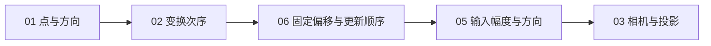

# 基础知识代码实践接续 · 2026-10-27

## 本轮实现范围

按[10 月 24 日复核计划](2026-10-24-project-review-and-next-plan.md)推进：补齐作答引导和本地服务管理，再增加 01／06／05／03 四个基础实验。原课阅读仍沿 GAMES101、Unity、GAMES104 的章节顺序；实践是原课旁的独立入口。

| 范围 | 当前实现 | 如何理解这个数字 |
| --- | --- | --- |
| 原课阅读 | 91 篇、806 个中文小节 | 阅读材料范围未因本轮实践扩充而改变 |
| 可运行实践 | 01、02、03、04、05、06、09、31，共 8 个实验 | 其余 52 项仍为计划中，不提供空的可运行入口 |
| 实践任务 | 14 个任务、68 组固定条件 | 分别检查核心规则，不用一个演示代表整类算法 |
| 原课定位 | 49 个原课小节中的指定机制 | 不表示整节、整门课已经实践覆盖 |
| 个人学习 | 独立完成与理解尚未评定 | 运行通过、材料交付和知识掌握分别记录 |

完整来源、计算方式与边界见[实践覆盖清单](../../domains/game-engine/experiments/web3d-learning/docs/practice-coverage.md)，使用约定见[实践说明](../../domains/game-engine/experiments/web3d-learning/docs/practice-learning.md)。

## 页面与启动改进

- 每个任务常显给定条件、初始错误、要修改的逻辑和运行后观察对象；明确答案在深色代码框中修改。变式参数和可选的个人解释分别标注。
- 起始代码标出 TODO；差异提示按点、分量、时间步骤或事件解释，保留原始数据。参考答案有明确入口，先说明原因，再可选择放入编辑区；替换可以撤销，查看不自动运行。
- 02／04／09 的模板升级至版本 2，版本 1 草稿保留，不静默覆盖旧答案。31 沿用原有模板版本。草稿恢复不自动执行，也不自动登记掌握。
- 增加本地服务的手动 `start/status/stop`，沿用 `127.0.0.1:5173`，便于保留同地址的浏览器草稿。管理入口核对进程归属、构建身份和内容；不按端口停止陌生进程。具体用法见[本地学习服务](../../domains/game-engine/experiments/web3d-learning/docs/local-service.md)。

新增管理代码不等于已经证明所有真实浏览器流程正常；本轮收尾验收状态在下方单独记录。

## 新增四个实验

| 实验与原课 | 独立任务 | 核对的关系与边界 |
| --- | --- | --- |
| 01 点与向量 · GAMES101 第 2 讲 | 点与单位方向；点积与投影；叉积与方向 | 两点之差、去除长度、非单位点积、投影与右手方向；零向量用 null 明确未定义的方向或夹角 |
| 06 相机跟随与更新顺序 · Unity 1.3 | 固定偏移；读取本帧位置 | 相机=本帧玩家位置+偏移，区分重复累加与读取上一帧；不将固定帧序结果称为真实引擎抖动测量 |
| 05 输入与方向转换 · Unity 1.4／4.1 | 输入幅度与运动／转向；随观察方向施力 | 零输入、轻推、满幅和反向分别生效；保留输入幅度，施力指令不等于恒速位移或完整刚体模拟 |
| 03 相机与投影 · GAMES101 第 4 讲 | 视图坐标；正交与透视 | 相机框架的逆、齐次除法和近远边界；保持原课看向 −Z、n>f、近面 +1／远面 −1 的约定 |

每题都有独立基准、正确实现、已知错误与非默认条件。二维坐标投影和数值表展示学习者返回的数据；参考结果单独标注。01／03／05／06 沿用短同步 JavaScript 函数、固定输入、Worker 取消和超时、记录回放、版本草稿及原课返回规则。

06 使用原课偏移 `(0,5,-7)`，其位置时间线是本题验收输入，不冒充原课车辆轨迹。03 不直接用旧 Three.js 默认 WebGL 深度符号充当 GAMES101 答案；05 不把轻推归一化为满幅输入。

## 接下来怎样学

先从[01 点与向量](http://127.0.0.1:5173/?lab=practice&experiment=01&from=chinese-reading&course=games101&chapter=02&section=part-2)的“两个点怎样得到方向”开始，再回到[02 变换次序](http://127.0.0.1:5173/?lab=practice&experiment=02&from=chinese-reading&course=games101&chapter=03&section=part-7)。这能先弄清点、位移和方向，再观察它们为何对平移产生不同反应。已有 02 草稿可以继续保留。

这只是实践接续建议，不替换原课阅读主线。每次围绕一条规则完成下面的过程即可，不增加强制考试：

1. 先看给定条件和初始错误，预测会出现什么差异。
2. 在深色代码框修改 TODO 附近的核心逻辑，运行当前条件。
3. 检查全部变式，观察图中和数值表中的实际结果。
4. 用一句话解释规则为何成立，以及零向量、暂停或边界条件下何时不适用；个人解释按需保存。

后续开发先接 07／08 的覆盖与深度比较，再补 10—12 的插值与纹理。高级系统继续保留在全量清单中，不能因基础实验增加而提前登记完成。

## 本轮验收记录

- 最终全量149项自动测试通过，0失败／跳过；类型检查与生产构建通过。包含真实Node线程执行生产Worker模块的14任务首例、死循环超时及取消后再运行。
- 真实本地服务冷启动、命令退出后查询、重复启动复用、停止与同地址重建通过；服务健康检查不代替页面交互验收。
- 浏览器作答、草稿、返回及桌面／手机流程：尚未登记本轮浏览器验收，不引用历史截图冒充本次验证。
- Git 提交与推送：按仓库规则在main统一完成，具体提交以Git记录为准。

实际验证与浏览器限制详见[10月27日记录](../../domains/game-engine/experiments/web3d-learning/docs/practice-validation-2026-10-27.md)。未验收事项保持未通过，不据此提高个人理解评分。历史首批验收保留原日期，见[10 月 22 日记录](../../domains/game-engine/experiments/web3d-learning/docs/practice-validation.md)。
